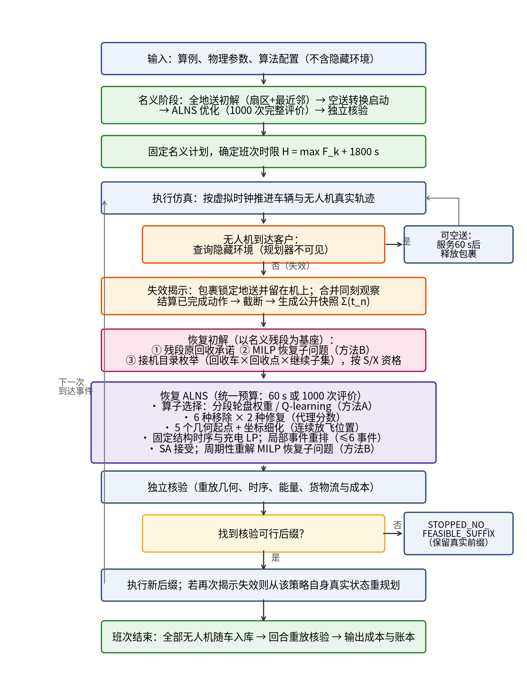

# 卡车—无人机协同配送中随机空中交付失效的事件触发恢复优化研究

（毕业论文初稿：第1—4章；第5、6章仅列提纲）

> **草稿说明**：本稿依据项目规范《无人机随机空中交付失效_V6_1_Codex完整实施规范_20261111》、项目代码（`src/tdr`）及项目文档撰写。第4章中的“MILP恢复子问题（B）”与“强化学习算子选择（A）”为本文设计中的方法，尚在实现，本稿不报告其任何计算结果；文中所有数值均为规范给定的参数或公式推导值，不是实验结果。参考文献均为可核验的真实文献，核对记录见 `references.md`。


# 第1章 绪论

## 1.1 研究背景

### 1.1.1 末端配送的成本压力

电子商务与即时零售的持续增长使城市末端配送（last-mile delivery）成为物流系统中成本占比高、组织难度大的环节。末端配送订单批量小、地点分散、服务时间要求高，车辆在城市道路中频繁启停，单位包裹的车程、司机工时和能源消耗均显著高于干线运输。Savelsbergh 与 Van Woensel 从城市物流角度总结了末端配送面临的拥堵、环境与服务水平等挑战[1]；Boysen 等从运筹学视角系统梳理了包括无人机、配送机器人、众包和自提柜在内的多种末端配送新模式[2]。在这些新模式中，以卡车为移动基地、由车载无人机完成部分包裹投递的“车机协同”配送受到学术界和产业界的持续关注[3-6]。

### 1.1.2 卡车—无人机协同配送

车机协同的基本思想是利用两类载具的互补性：卡车载量大、续航长，但受道路网络和交通条件约束；无人机速度快、不受道路约束，但载荷与续航有限。Murray 与 Chu 提出的“飞行助手旅行商问题”（Flying Sidekick Traveling Salesman Problem，FSTSP）以及并行无人机调度问题（PDSTSP），奠定了该领域的建模基础[7]；Agatz 等随后提出带无人机的旅行商问题（TSP-D）并给出精确与启发式方法[8]。此后研究逐步扩展到多车多机[9-11]、一车多机[12]、多票航次[13,14]、跨车起降[15-17]以及沿道路途中起降[18-20]等更贴近运营的情形。

现有车机协同模型多数是确定性的：模型默认每一次空中投递都能按计划完成。然而，空中投递是否可行，往往取决于客户现场的实际条件，例如投放点是否被占用、收件设施是否可用、现场是否存在临时障碍或安全限制等。这类条件通常只有当无人机实际飞抵客户上空时才能确认。一旦空中交付失败，包裹仍留在无人机上，无人机需要携带货物与卡车重新会合，失败包裹则必须改由卡车地面送达。若事先没有可执行的恢复机制，这类事件会引发无人机滞空等待、电量不足、车辆绕行与班次超时等一连串后果。

## 1.2 问题提出

本文研究如下场景：一个仓库配备 5 辆卡车与 5 架同型无人机，为 50 或 100 个客户配送包裹（一客一件）。卡车沿客户点行驶并可在任一客户点停车；无人机可在卡车实际行驶轨迹上的任意位置自动放飞（即连续放飞位置），可一次携带多件包裹执行多票航次，但必须在某个客户点由停靠的卡车回收，最终随卡车返回仓库，不能独立飞回仓库。每辆卡车最多承载 2 架无人机，在车且设备就绪的无人机可在行驶或停车期间车载充电。

在每个随机环境中，有 1—2 个客户（等概率）事先被私下设定为“不能接受空中交付”，规划器在执行前并不知道这些客户是谁；只有当无人机实际飞抵该客户时，失败才被揭示。失败包裹留在机上并被锁定为“必须地送”，无人机需与某辆卡车在客户点会合完成回收（R）、异常卸货交接（U），再由该卡车地面送达（G）。由此产生两个相互关联的问题：

1. **恢复决策问题**：失败揭示后，应由哪辆卡车、在哪个客户点、以何种顺序回收受影响的无人机？无人机应立即带货返回，还是先继续完成机上其他可空送包裹？失败包裹由谁、在何处地送？其余尚未执行的配送计划应如何随之调整？
2. **回收政策问题**：若规定受影响航次只能由其原放飞卡车回收（本文称为 S 政策，same-truck），与允许由任一合格卡车回收（X 政策，cross-truck）相比，全班成本、可行性和恢复过程有何差异？

本文以全班实际成本为评价口径，成本由车辆里程费用（燃油与维护）、电费（车载充电与回库补电）和司机工时价值三部分构成，并须满足无人机电量、机位、单起降通道、司机串行作业和班次时限 $H$ 等约束。

## 1.3 研究意义

**理论意义。** 第一，本文把“到点才揭示的空中交付失效”纳入多车多机协同配送模型，刻画了失败包裹在无人机、卡车之间的真实保管转移和锁定地送规则，补充了现有确定性或鲁棒车机模型对执行期交付失效刻画不足的问题。第二，本文在同一模型中同时考虑连续放飞位置、载荷相关能耗、行驶充电、跨车回收与客户点重访，并给出事件触发的滚动重优化框架，为动态车机协同问题提供一种可核验的建模与求解范式。第三，本文将精确数学规划（MILP）嵌入恢复决策、将强化学习用于大邻域搜索的算子选择，探讨数学启发式与学习引导方法在动态车机问题中的结合方式。

**实践意义。** 本文为配送企业评估“是否允许跨车回收”这一运营规则提供了可复现的比较方法。跨车回收需要车辆间的协调与信息共享，会增加运营管理复杂度；只有在相同环境、相同求解预算下进行配对比较，才能判断其是否带来足以抵消管理成本的收益。需要强调的是，规范明确指出 X 政策并不必然在每个随机环境中都优于 S 政策（见第3.6节），本文的比较以如实报告为原则。

## 1.4 研究问题

本文围绕以下研究问题（Research Questions，RQ）展开：

- **RQ1（建模）**：如何在包含连续放飞、多票航次、行驶充电、跨车回收和客户点重访的多车多机系统中，严格刻画“到点揭示的空中交付失效”及其后的货物保管、回收与地送过程？
- **RQ2（算法）**：如何设计一种在信息逐步揭示条件下可在有限计算预算内给出经独立核验可行方案的恢复算法？精确的恢复子问题求解与学习引导的算子选择能否改进基础 ALNS 的恢复质量与稳定性？
- **RQ3（政策）**：在相同隐藏环境与相同求解预算下，S 与 X 两种回收政策的全班成本、可行性与恢复动作结构（同点/异点、原车/跨车）有何差异？这些差异是否稳定？

## 1.5 主要研究内容与贡献

本文的主要工作与预期贡献如下（其中贡献 2、3 为本文设计、正在实现的方法，其效果须由第5章的正式实验检验，本稿不作结论）：

1. **事件触发的车机协同恢复框架。** 建立“名义计划—执行仿真—到点揭示—快照截断—残段恢复—独立核验”的闭环框架。规划器只能读取公开快照（已观察事件、真实实体状态、冻结残段与剩余需求），不接触隐藏环境；每次失败揭示时，以名义计划的未执行残段为基座进行恢复，并对全部候选方案进行独立的物理与成本重放核验。
2. **MILP 与 ALNS 融合的恢复求解（方法 B）。** 将失败后的“回收卡车—回收客户点—插入位置—继续配送子集—失败票地送位置”联合决策写成一个可由 HiGHS 求解的混合整数线性规划子问题，S 政策只需将回收车辆集合限制为原放飞车；剩余路径与无人机任务仍由 ALNS 优化，两者交替协调。
3. **强化学习引导的算子选择（方法 A）。** 以搜索停滞程度、退火温度阶段和失效类型构成离散状态，以“移除—修复”算子对为动作，用 Q-learning 替代传统 ALNS 的分段轮盘权重，在不读取隐藏信息的前提下根据搜索状态自适应地选择算子。
4. **S/X 回收政策的配对比较设计。** 在 6 个实例（C50、R50、RC50、C100、R100、RC100）、每图 10 个环境种子上，令 S/X 共享同一名义计划、同一隐藏失败集合、同一物理参数与同一求解预算，以配对差值 $\Delta_s=C_{S,s}-C_{X,s}$ 为核心统计量，并区分“同点/异点 × 原车/跨车”两层恢复分类。

## 1.6 论文结构

本文共六章，结构安排如下：

- **第1章 绪论**：介绍研究背景、问题、意义、研究问题与主要贡献。
- **第2章 文献综述**：从卡车—无人机协同路径、动态随机车辆路径与实时恢复、ALNS 与数学启发式、学习引导的元启发式四个方面梳理相关研究，并总结研究空白。
- **第3章 问题描述与数学模型**：给出场景、假设、符号、决策变量、目标与约束，定义信息结构、事件过程以及 S/X 政策。
- **第4章 求解算法**：提出事件触发的 ALNS 数学启发式框架，详细介绍名义计划、事件触发恢复、ALNS 组件、MILP 恢复子问题（B）与强化学习算子选择（A）。
- **第5章 数值实验**：待正式实验完成后撰写。
- **第6章 结论与展望**：待正式实验完成后撰写。


# 第2章 文献综述

本章从四个方面梳理与本文相关的研究：卡车—无人机协同路径问题（2.1节）、动态随机车辆路径与实时恢复（2.2节）、自适应大邻域搜索与数学启发式（2.3节）、学习引导的元启发式与算子选择（2.4节），最后在2.5节归纳研究空白。

## 2.1 卡车—无人机协同路径问题

### 2.1.1 单车单机：FSTSP 与 TSP-D

Murray 与 Chu 最早系统地提出了车机协同配送的两类基本模型[7]：一是飞行助手旅行商问题（FSTSP），一辆卡车与一架无人机协同服务客户，无人机从仓库或客户点起飞、服务一个客户后在下游客户点或仓库与卡车会合；二是并行无人机调度旅行商问题（PDSTSP），无人机直接从仓库往返服务客户，卡车独立完成其余客户。该文给出了混合整数规划模型与启发式算法，并明确刻画了起飞准备、回收时间与续航约束，后续大量研究沿用了其“节点起降、同步会合”的建模框架。

Agatz 等提出了带无人机的旅行商问题（TSP-D），在“先路由后划分”的思路下给出整数规划模型以及基于动态规划的精确与启发式方法[8]。Ha 等将目标从最小化完工时间改为最小化运营成本（包括运输成本和等待造成的浪费时间成本），提出了 min-cost TSP-D 及其 MILP 模型和 GRASP 等启发式[21]。Carlsson 与 Song 则从连续近似角度分析了一车一机协同相对于单车配送的效率增益，为理解车机协同的潜在收益提供了理论依据[22]。Bogyrbayeva 等尝试用深度强化学习直接构造 TSP-D 解[23]，反映了学习方法向车机问题的渗透。

上述研究普遍假设：无人机每次只服务一个客户，起降只能发生在客户节点或仓库，并且所有空中投递都能按计划完成。

### 2.1.2 多车多机、多票航次与跨车协作

面向实际配送规模，研究逐步扩展到多车多机。Wang 与 Sheu 建立了多车多机的带无人机车辆路径问题（VRPD）模型，并设计了分支定价精确算法[9]。Sacramento 等针对多卡车、每车一架无人机的 VRPD 设计了自适应大邻域搜索（ALNS）元启发式[10]，是本文主搜索框架最直接的方法来源之一。Schermer 等提出了求解 VRPD 及其若干变体的数学启发式[11]，其中包括允许无人机在道路弧上若干离散点起降的变体。Murray 与 Raj 将 FSTSP 推广到一车多机的 mFSTSP，并刻画了多架无人机在同一卡车上起降时的排队与载荷相关续航[12]。

多票航次方面，Masmoudi 等研究了配备多包裹舱的无人机车辆路径问题，允许一个航次服务多个客户，并允许无人机在客户节点与卡车会合后进行换电与补货[13]。Jiang 等提出了多访问、柔性停靠的 VRPD，允许无人机在多个客户间连续服务并由不同卡车回收，采用 ALNS 求解并以线性规划评价给定结构的时序[14]。

跨车协作是近年的研究热点。Kim 等研究了面向优质配送服务的多车多机协同，允许无人机由一辆卡车在客户点放飞、由另一辆卡车在另一客户点回收[24]。Long 等面向城市应急响应提出了动态的卡车—无人机协作与集成路径规划，允许跨车回收，采用禁忌搜索并以递归方式评价时序[16]；Zhao 等在此基础上给出了一种分解式数学启发式，将需求分配、卡车路线与无人机调度分层协调[17]。Fan 等研究了带灵活跨车操作与机位约束的车机协同路径问题，提出了带自适应大邻域扰动的模因算法[15]。需要指出，这些文献中的“动态”多指车机之间可变的协作关系，而非执行过程中逐步揭示的随机信息；它们通常也限制起降只能发生在客户节点或仓库。

### 2.1.3 途中起降与连续放飞位置

当卡车不必停车即可放飞或回收无人机时，起降位置不再局限于离散节点。Marinelli 等较早提出“途中（en route）”车机配送，允许卡车在道路弧上的某一点放飞或回收无人机[18]。Masone 等研究了带边上起降的多访问无人机路径问题（MVDRP-EL），用全局连续方法在道路边上确定起降位置，并结合离散与连续改进的迭代方法求解[19]。Thomas 等研究了考虑无人机调度与途中作业的一车多机协同配送系统[20]。规范核对的文献也显示，Jiang 等与 Long 等均将道路弧上离散起降或行驶中起降列为未来研究方向[14,16]。

本文采用“放飞可沿卡车实际轨迹连续选择、回收必须在客户点停车完成”的非对称设定：放飞位置由道路弧参数 $\lambda\in[0,1]$ 连续表示，而回收必须满足车辆真实到场、司机与通道可用和机位可预留等同步条件。这一设定介于纯节点模型与全连续起降模型之间，是本文的设备与作业假设，而非对现有商用平台能力的证明。

### 2.1.4 能耗与充电建模

无人机能耗模型直接影响航次可行性。Dorling 等提出了随载荷与电池质量线性变化的多旋翼功率近似，并据此研究了无人机配送路径问题[25]；Zhang 等系统比较并评估了多种配送无人机能耗模型，指出不同模型对同一任务的能耗估计可能相差显著[26]。在车机协同中，大多数研究以固定续航时间或固定航程表示无人机能力，部分研究考虑了换电或在车充电，但很少同时考虑“逐段真实载荷能耗、空中等待能耗、行驶期间车载充电及车辆供电预算”。本文沿用规范给定的载荷相关巡航与悬停能耗、按阶段建立能量链，并把车载充电作为受单槽功率、整车功率与车载交流电量预算约束的可选决策。

### 2.1.5 不确定性与动态车机协同

已有考虑不确定性的车机研究主要分为两类。第一类为静态的鲁棒或随机优化：Sun 等研究了旅行时间不确定下的车机协同鲁棒优化[27]；Wu 等研究了人道主义物流中带柔性停靠无人机的鲁棒车辆路径问题[28]；Dukkanci 研究了不确定条件下兼顾选址与路径决策的车机配送问题[29]。这类模型在执行前给出对不确定性免疫的方案，但不涉及执行中的重新规划。第二类为动态问题：Ulmer 与 Thomas 研究了异质车队（无人机与车辆）下随机到达请求的当日配送[30]；Chen 等用深度 Q 学习为车辆与无人机的当日配送分配决策[31]；Gu 等研究了同时包含计划配送与随机到达取件请求的动态车机路径问题[32]。这类研究的随机性主要来自需求的到达，而非已计划空中投递在执行时的失效。

综上，现有车机文献尚未建立“到客户后才揭示空中交付不可用，而地面送达与车载回收仍可行”的失效机制，也未研究失效后无人机携带失败包裹与卡车会合、交接并改为地送的完整恢复过程。

## 2.2 动态随机车辆路径与实时恢复

### 2.2.1 动态与随机车辆路径问题

动态车辆路径问题（DVRP）是指部分输入在执行过程中才被揭示、需要据此调整路线的问题。Pillac 等按信息的动态性与随机性对 DVRP 进行了分类综述[33]；Psaraftis 等回顾了 DVRP 三十年的发展[34]；Ritzinger 等综述了动态与随机车辆路径问题的模型与方法[35]；Soeffker 等从规范性分析（prescriptive analytics）视角梳理了随机动态车辆路径的研究，强调对未来信息的利用方式[36]。Powell 提出了随机优化的统一框架，将序贯决策问题的求解策略归纳为策略函数近似、成本函数近似、价值函数近似与前瞻策略等几类[37]。

在求解策略上，一类方法在每个决策时刻求解确定性的剩余问题（即“事件触发的重优化”或“滚动重优化”），另一类方法通过情景采样、近似动态规划等方式考虑未来随机性。Bent 与 Van Hentenryck 提出了基于多情景的规划方法，在每个决策点用采样情景评价候选决策[38]。按 Powell 的分类，本文的方法属于“只利用已观察信息、求解确定性剩余问题”的一类策略：规划器在每次失效揭示后，基于公开快照重新优化剩余计划，不对未揭示的失败客户进行情景采样。这样做的理由是，本文的失效客户集合在全部客户中随机抽取、数量仅 1—2 个，且规范要求严格的信息隔离；引入前瞻策略属于另外的研究设计。

### 2.2.2 车辆路径中的干扰管理与实时恢复

干扰管理（disruption management）研究计划执行中发生意外事件后如何以最小代价恢复运营。Li 等提出了车辆重调度问题（VRSP），研究车辆在途中故障后如何重新指派其余任务[39]，并进一步研究了带时间窗的实时车辆改路问题[40]。Mu 等研究了车辆故障下的车辆路径干扰管理，并以禁忌搜索求解[41]。Eglese 与 Zambirinis 综述了公路货运中车辆路径与调度的干扰管理研究[42]。

这些研究的共同特点是：干扰发生后需在“偏离原计划的代价”与“新计划的质量”之间权衡，并须尊重已执行部分。本文的恢复问题与之类似，但具有三点特殊性：（1）干扰对象是无人机的单次空中投递，而非整车故障；（2）失败包裹物理上仍在空中无人机上，恢复必须先完成车机同步回收，涉及无人机剩余电量、空中等待能耗与车载机位；（3）回收车辆既可能是原放飞车，也可能是其他卡车，这正是 S/X 政策比较的对象。

## 2.3 自适应大邻域搜索与数学启发式

### 2.3.1 LNS 与 ALNS

大邻域搜索（LNS）由 Shaw 提出，通过反复“移除—重插”解的一部分来探索大规模邻域[43]。Ropke 与 Pisinger 在 LNS 基础上提出了自适应大邻域搜索（ALNS）：维护多个移除与修复算子，根据各算子的历史表现以分段更新的权重进行轮盘选择，并以模拟退火（SA）[44]作为接受准则[45]。Pisinger 与 Ropke 进一步把 ALNS 作为统一框架应用到多类车辆路径问题[46]。ALNS 现已成为车机协同问题最常用的求解框架之一[10,14,15]。

关于 ALNS 的组成要素，Windras Mara 等对 ALNS 的算法设计与应用进行了全面综述[47]；Voigt 回顾并比较了车辆路径 ALNS 中常用的移除与修复算子[48]；Santini 等比较了 ALNS 中多种接受准则，表明接受准则的选择会显著影响算法表现[49]。值得注意的是，Turkeš 等对大量 ALNS 文献进行元分析，发现自适应选择层对解质量的平均贡献相对有限，且依赖于具体问题与算子设计[50]。这一结论提示：在本文问题上，是否需要以及如何改进算子选择机制，应通过受控实验而非默认假设来判断。

### 2.3.2 数学启发式

数学启发式（matheuristic）是元启发式与数学规划的结合。Archetti 与 Speranza 综述了路径问题中的数学启发式，将其归纳为分解方法、以数学规划为改进步骤的方法和基于列生成/分支定价的启发式等类型[51]。在车机问题中，Schermer 等的 VRPD 数学启发式[11]、Zhao 等的分解式数学启发式[17]以及 Jiang 等在 ALNS 中以 LP 评价时序的做法[14]都属于这一范畴。Hendel 将 ALNS 思想用于一般混合整数规划，在多个受限子 MIP 邻域间自适应地分配求解工作[52]。在求解器方面，开源的 HiGHS 线性/混合整数规划求解器[53]已通过 SciPy[54] 提供 Python 接口，使得在启发式中嵌入精确子问题的工程门槛显著降低。

本文的数学启发式包括三个层次：ALNS 负责离散结构搜索；固定结构下的时序与充电由 LP 求解；失败后的恢复决策由 MILP 子问题精确求解（方法 B）。

## 2.4 学习引导的元启发式与算子选择

机器学习与组合优化的结合是近年的研究热点。Bengio 等从方法论层面总结了机器学习在组合优化中的三种角色：端到端学习、学习配置算法参数、以及在算法内部学习决策[55]。Karimi-Mamaghan 等专门综述了机器学习服务于元启发式的方式，包括算法选择、参数调整、算子选择和解的初始化等[56]。

算子选择问题在超启发式（hyper-heuristic）领域有较长的研究历史。Burke 等综述了超启发式的研究现状，其中基于强化学习的低层启发式选择是重要分支[57]。Q-learning[58]因其表格形式简单、无需环境模型，常被用于算子选择：Qin 等提出了基于强化学习的超启发式求解异质车队车辆路径问题[59]；Wang 等提出了强化学习引导的 ALNS 求解带时间窗车辆路径问题[60]。在深度强化学习方面，Kallestad 等提出了通用的深度强化学习超启发式框架[61]；Reijnen 等提出 DR-ALNS，根据搜索状态在线选择算子、调整参数并控制接受准则[62]；Johnn 等提出了图强化学习驱动的神经 ALNS 框架[63]。多臂老虎机是另一类在线学习方法：Cai 等提出的 Balans 以多臂老虎机在线选择 ALNS 邻域求解混合整数规划，无需离线训练[64]。

上述研究多以静态问题为对象，学习信号来自单次求解过程。在本文的动态恢复情境中，每次失效触发的重规划预算有限（规范默认每次恢复 60 s 墙钟或 1000 次完整评价），可用于在线学习的样本较少；同时，规划器不得读取隐藏环境信息，学习所用的状态特征必须完全来自公开的搜索过程。因此，本文采用低维离散状态与表格 Q-learning（方法 A），以控制学习开销并保证信息隔离。

## 2.5 研究空白

表2-1 归纳了代表性文献与本文在问题特征和求解方法上的差异。

**表2-1 代表性文献与本文的比较**

| 文献 | 车/机规模 | 跨车回收 | 途中/连续放飞 | 不确定性来源 | 执行中重规划 | 求解方法 |
|---|---|---|---|---|---|---|
| Murray 与 Chu[7] | 1车1机 | 否 | 否（节点） | 无 | 否 | MILP+启发式 |
| Agatz 等[8] | 1车1机 | 否 | 否（节点） | 无 | 否 | IP+动态规划 |
| Sacramento 等[10] | 多车，每车1机 | 否 | 否（节点） | 无 | 否 | ALNS |
| Schermer 等[11] | 多车多机 | — | 变体中含弧上离散点 | 无 | 否 | 数学启发式 |
| Marinelli 等[18] | 1车1机 | 否 | 是（途中） | 无 | 否 | 启发式 |
| Masone 等[19] | 1车1机 | 否 | 是（边上连续） | 无 | 否 | 离散+连续迭代改进 |
| Jiang 等[14] | 多车多机 | 是 | 否（列为未来方向） | 无 | 否 | ALNS+LP时序 |
| Fan 等[15] | 多车多机 | 是（含机位约束） | 否 | 无 | 否 | 模因算法+ALNS扰动 |
| Long 等[16] | 多车多机 | 是 | 否（列为未来方向） | 无 | 否 | 禁忌搜索 |
| Sun 等[27] | 多车多机 | 是 | 否 | 旅行时间 | 否（鲁棒） | 鲁棒优化 |
| Gu 等[32] | 车机协同 | — | 否 | 随机取件请求 | 是 | 动态启发式 |
| Chen 等[31] | 车辆+无人机 | — | 否 | 随机请求 | 是 | 深度Q学习 |
| **本文** | **5车5机，每车≤2机位** | **是（S/X对照）** | **是（轨迹连续放飞）** | **到点揭示的空中交付失效** | **是（事件触发）** | **ALNS+LP+MILP恢复+Q学习选算子** |

注：“—”表示该特征不是该文的研究重点或本稿尚未从原文核实。表中特征依据各文献题名、摘要和项目规范第11章的原文核对记录归纳，定稿前应逐条对照原文复核。

归纳起来，现有研究存在以下空白：

1. **失效机制空白。** 现有车机模型多为确定性或针对旅行时间、需求到达的不确定性，尚未刻画“到点才揭示的空中交付失效”，以及失败包裹仍在机上、必须经“回收—交接—地送”才能妥投的物理过程。
2. **恢复过程与政策比较空白。** 跨车回收在静态模型中已被证明可以提升协同灵活性，但在执行期失效恢复中，限制原车回收与允许跨车回收的差异尚缺乏在相同环境、相同预算下的配对比较。
3. **连续放飞与能量—充电耦合空白。** 同时考虑轨迹连续放飞、逐段载荷能耗、空中等待能耗、行驶充电与车载供电预算的多车多机模型较少，在动态恢复情境下更为少见。
4. **求解方法空白。** 现有车机 ALNS 多采用分段轮盘权重选择算子，恢复决策也多由启发式插入完成；将恢复决策写成精确 MILP 子问题并与 ALNS 融合、以及在有限重规划预算下以强化学习选择算子，在动态车机恢复问题上尚未见系统研究。

本文针对上述空白开展研究，第3章建立模型，第4章给出算法。


# 第3章 问题描述与数学模型

本章首先描述配送场景与业务规则（3.1节），给出建模假设（3.2节）与符号（3.3节），然后建立给定决策时刻的剩余问题模型（3.4—3.5节），最后刻画隐藏失效的信息结构与事件过程（3.6节），并定义 S/X 两种回收政策及其统计口径（3.7节）。本章的符号与规则以项目规范 V6.1 为准。

## 3.1 问题描述

### 3.1.1 资源与订单

配送系统由一个仓库、5 辆卡车 $k\in\mathcal{K}$ 和 5 架具有唯一编号的同型无人机 $d\in\mathcal{D}$ 组成。每辆卡车出库时携带 1 架无人机，任一时刻最多承载 2 架（2 个机位）；每车有 1 条车载起降作业通道和 1 名司机。客户集合为 $\mathcal{C}$（$|\mathcal{C}|=50$ 或 $100$），每个客户恰有一件包裹 $p\in\mathcal{P}$，包裹质量为 $m_p$，记包裹 $p$ 所属客户为 $c(p)$。包裹不可拆分；卡车载货容量不构成约束；单个无人机航次的总载荷不超过 30 kg。所有客户均可地面送达，且在名义上都具有空中交付资格。

### 3.1.2 作业与位置

司机执行的人工作业包括：地面交付 G（50 s）、无人机装货与起飞准备 P（30 s）、动力回收 R（30 s）和异常卸货交接 U（20 s）；人工作业相互串行，且只能在卡车停靠于客户点（或出库时在仓库）时执行。自动放飞 L（10 s）不占用司机，可以与卡车行驶重叠。无人机成功空中交付一票需要悬停服务 60 s，服务结束后才释放包裹、减轻载荷。

卡车只在客户点停车，客户点以外不设运营停车点；但无人机的放飞位置不受客户节点限制，可沿卡车实际行驶轨迹连续选择。回收则必须在客户点完成：卡车停靠在某客户点，无人机飞抵该点，满足司机、通道与机位条件后执行 R。全部客户点（包括已服务客户、其他卡车负责的客户以及空中交付失效的客户）都可以作为回收点，卡车可以专程插入或重复访问客户点（每次访问具有独立的访问编号 visit_id）。所有出飞的无人机最终都必须在客户点被回收，随其实际承运卡车返回仓库，不允许独立飞回仓库。

### 3.1.3 隐藏失效与恢复

每个随机环境（由环境种子标识）中，有 $M\in\{1,2\}$ 个客户被私下设定为不能接受空中交付，$M$ 等概率取值，失效客户从全部有空送资格的客户中无放回抽取。规划器在执行前不知道 $M$ 与失效名单；只有当无人机携带某客户的包裹实际飞抵该客户时，才观察到该包裹能否空中交付。若不能，则该包裹留在机上，被锁定为“必须地送”，并立即触发重规划。若某失效客户最终由卡车地面送达，则该失效不会被观察到。

失效发生后，规划器可以为受影响的无人机选择：（A）立即携带机上全部剩余包裹返回卡车；（B）携带失败包裹继续完成机上其他可空送包裹后再返回；（C）完成部分包裹后返回。回收后，机上未交付包裹经 U 交接给回收卡车，再由该卡车地面送达。若在失败客户处原地等车，则恢复的实体顺序为“空中等待 → R → U → G”，车辆到达、无人机回收或卸货完成都不等于订单妥投。

### 3.1.4 成本与班次

评价口径为全班真实成本，由三部分组成：车辆里程费用（燃油与维护）、电费（车载充电与回库补电）以及司机工时价值。所有卡车须在班次时限 $H$ 内完成全部交付、回收、承运与返库责任，其中 $H$ 由经核验的名义计划确定：$H=\max_k F_k^{\mathrm{nom}}+1800$ s，且不因发生第二次失效而延长。

### 3.1.5 算例

本文使用规范附录给出的 6 个算例：C50、R50、RC50、C100、R100、RC100，共 450 个客户需求。C、R、RC 分别表示聚类、随机与混合的客户空间分布。各算例客户坐标位于约 20 km × 20 km 的平面区域内，仓库位于 $(10000,10000)$ m，包裹质量在 0.2—5 kg 之间；三个 50 客户算例的总货重均为 50.5 kg，三个 100 客户算例均为 101 kg。卡车与无人机的距离均按二维欧氏距离计算。这些算例是合成实例，不应被解读为真实城市路网。

## 3.2 建模假设

1. **失效对象假设**：失效仅指客户空中交付作业不可用；无人机本体能正常飞行，客户地面送达与卡车停车回收能力保持有效。宏观上客户交付位置与其邻近的车辆停靠位置聚合为同一节点。
2. **信息假设**：失效在无人机实际到达客户时即时揭示，不考虑确认延迟；决策延迟取 0（虚拟时钟下即时决策），求解器计算时间单列记录。
3. **运动假设**：卡车在相邻访问之间以 $v_T=25/3$ m/s 匀速直线行驶；无人机以 $v_D=15$ m/s 匀速直线飞行；行驶放飞的位置由道路弧上的参数 $\lambda$ 确定。
4. **能耗假设**：无人机巡航能耗与航段距离成正比、与载荷相关的参考航程成反比；悬停、服务、放飞、回收及空中等待的功率随载荷线性变化；随车移动不计空中能耗。
5. **充电假设**：无人机固定在实际承运车机槽内且设备就绪时，可在卡车行驶或停车期间充电；本机 P/L/R/U 期间、离车期间不充电；每车出库时具有 4 kWh 交流电量预算，途中不补充。
6. **成本假设**：油价、油耗、维护费、电价及工时价值为固定研究参数，不在线更新；仓库直充只计费用，不增加作业时间。
7. **恢复范围假设**：已完成和正在不可撤销执行的动作冻结；未受失效影响的在途航次保留其回收承诺；保留地送的原普通任务维持原相对服务顺序；不额外启用已返库或未出库车辆。

## 3.3 符号说明

表3-1 列出本文的主要符号。

**表3-1 主要符号**

| 符号 | 含义 |
|---|---|
| **集合** | |
| $\mathcal{K}$ | 卡车集合，$\lvert\mathcal{K}\rvert=5$，索引 $k$ |
| $\mathcal{D}$ | 无人机集合，$\lvert\mathcal{D}\rvert=5$，索引 $d$ |
| $\mathcal{C}$ | 客户集合，索引 $i,j$；$0$ 表示仓库 |
| $\mathcal{P}$ | 包裹集合（一客一件），索引 $p$；$c(p)$ 为其客户 |
| $\mathcal{V}_k$ | 卡车 $k$ 的候选客户访问集合（可含同一客户的多次访问），索引 $v,w$；$j(v)$ 为访问 $v$ 的客户；$o_k,e_k$ 为出库与入库边界 |
| $\mathcal{S}_d$ | 无人机 $d$ 的候选航次集合（按执行先后成链），索引 $s$ |
| $\mathcal{U}(t)$ | 时刻 $t$ 尚未妥投的包裹集合 |
| $\mathcal{G}(t)$ | 截至 $t$ 已观察到空中交付失效、必须地送的包裹集合 |
| $\Omega_d(t)$ | 时刻 $t$ 无人机 $d$ 机上未交付包裹集合 |
| $\mathcal{S}^{\mathrm{aff}}(t)$ | 截至 $t$ 受已观察失效影响的在途航次集合 |
| $\mathcal{K}^{\mathrm{elig}}(t)$ | 时刻 $t$ 仍在班次内、可承担回收的卡车集合 |
| $\mathcal{B}$、$\mathcal{H}$ | 充电阶段集合（索引 $b$）与全局时间区间集合（索引 $h$） |
| **参数** | |
| $D_{ij}$ | 位置 $i,j$ 间欧氏距离（m） |
| $v_T, v_D$ | 卡车、无人机速度：$25/3$ m/s、$15$ m/s |
| $\tau_G,\tau_P,\tau_L,\tau_R,\tau_U,\tau_S$ | 作业时长：50、30、10、30、20、60 s（$\tau_S$ 为空中成功交付服务） |
| $m_p$, $\bar m$ | 包裹质量；单航次载荷上限 $\bar m=30$ kg |
| $E_{\mathrm{cap}}, E_{\min}$ | 电池容量 3.9688 kWh；回收余电下限 $0.1E_{\mathrm{cap}}=0.39688$ kWh |
| $R_{\mathrm{cal}}(m)$ | 载荷 $m$ 下的参考航程 $28000-400m$（m） |
| $P_h(m)$ | 载荷 $m$ 下的悬停类功率（kW） |
| $\beta_{c},\beta_{h}$ | 巡航、悬停能耗系数，基准取 1 |
| $P_{\mathrm{slot}}, P_{\mathrm{truck}}$ | 单机槽交流功率上限 2 kW；整车交流功率上限 4 kW |
| $A_k^0$ | 每车出库交流电量预算 4 kWh |
| $\eta_{\mathrm{slot}},\eta_{\mathrm{aux}},\eta_{\mathrm{dep}}$ | 机槽充电效率 0.90；车载交流输出综合效率 0.85；仓库直充效率 0.90 |
| $c_{\mathrm{km}}$ | 单位里程费用 1.67693 元/km |
| $c_{\mathrm{veh}}, c_{\mathrm{dep}}$ | 车载净充电单价、仓库补电单价（元/净 kWh） |
| $w_s$ | 司机工时价值（元/s） |
| $H$ | 班次时限：$\max_k F_k^{\mathrm{nom}}+1800$ s |
| **决策变量** | |
| $x_{vw}^k\in\{0,1\}$ | 卡车 $k$ 在访问 $v$ 后紧接访问 $w$ |
| $g_{pv}^k\in\{0,1\}$ | 包裹 $p$ 由卡车 $k$ 在访问 $v$（$j(v)=c(p)$）地面交付 |
| $y_{ps}\in\{0,1\}$ | 包裹 $p$ 由航次 $s$ 空中交付 |
| $u_{s}\in\{0,1\}$ | 航次 $s$ 被启用 |
| $\ell_{s}^k\in\{0,1\}$ | 航次 $s$ 由卡车 $k$ 放飞 |
| $a_{s,vw}\in\{0,1\}$, $\bar a_{s,v}\in\{0,1\}$ | 航次 $s$ 在弧 $v\to w$ 上行驶放飞（ROAD）或在访问 $v$ 驻车放飞（STOP） |
| $\lambda_s\in[0,1]$ | ROAD 放飞时 L 结束点在弧上的位置参数 |
| $\rho_{sv}^k\in\{0,1\}$ | 航次 $s$ 由卡车 $k$ 在访问 $v$ 回收 |
| $t_v^{\mathrm{a}}, t_v^{\mathrm{d}}$ | 访问 $v$ 的到达与离开时刻 |
| $\sigma_e$ | 作业或阶段 $e$ 的开始时刻（如 $\sigma_s^{L},\sigma_s^{R},\sigma_s^{U}$） |
| $E_{d,n}$ | 无人机 $d$ 第 $n$ 个阶段端点的电量 |
| $q_{bh}\ge 0$ | 充电阶段 $b$ 在区间 $h$ 内消耗的车载交流电量（kWh） |
| $F_k$ | 卡车 $k$ 完成全部责任并入库的时刻 |
| $z$ | 全队最晚机体入库时刻 |

其中派生成本参数为
$$
c_{\mathrm{km}}=\frac{8.57\times 14.9}{100}+0.40=1.67693,\quad
c_{\mathrm{dep}}=\frac{0.731012}{\eta_{\mathrm{dep}}}\approx 0.81224,\quad
c_{\mathrm{veh}}=\frac{0.731012}{\eta_{\mathrm{aux}}\eta_{\mathrm{slot}}}\approx 0.95557,\quad
w_s=\frac{105976/2088}{3600}\approx 0.014099 .
$$

## 3.4 能量与充电模型

### 3.4.1 无人机能耗

记 $m$ 为某一阶段机上实际未卸载包裹的总质量（kg）。参考航程与能耗函数为
$$
R_{\mathrm{cal}}(m)=28000-400m,\qquad 0\le m\le 30 \qquad (3.1)
$$
$$
E_{\mathrm{fly}}(\ell,m)=\beta_c\,E_{\mathrm{cap}}\,\frac{\ell}{R_{\mathrm{cal}}(m)} \qquad (3.2)
$$
$$
P_h(m)=\beta_h\left[P_0+\left(P_{30}-P_0\right)\frac{m}{30}\right],\quad P_0=\frac{E_{\mathrm{cap}}}{29/60},\quad P_{30}=\frac{E_{\mathrm{cap}}}{18/60} \qquad (3.3)
$$
$$
E_{\mathrm{hov}}(\Delta t,m)=P_h(m)\,\frac{\Delta t}{3600} \qquad (3.4)
$$
即空载与满载 30 kg 时的参考航程分别为 28 km 与 16 km，参考悬停时间分别为 29 min 与 18 min。式（3.2）—（3.4）是与公开机型规格同尺度的仿真插值，不是实测功率曲线。

机载能耗包括：各飞行航段的 $E_{\mathrm{fly}}$；自动放飞 L 与动力回收 R 的 $E_{\mathrm{hov}}$；每票成功空送 60 s 服务的 $E_{\mathrm{hov}}$（按释放该包裹前的载荷计）；以及接机等待等全部空中等待的 $E_{\mathrm{hov}}$。失败在服务开始前揭示，不扣除不存在的成功服务时间，但失败包裹不释放、不减载，之后的飞行与等待照常按含失败包裹的载荷扣电。

### 3.4.2 车载充电

将时间轴按充电资格、实际承运车及作业阶段的变化切分为区间 $h\in\mathcal{H}$，长度为 $\Delta_h$（s）。充电阶段 $b\in\mathcal{B}$ 定义为“同一架无人机、同一实际承运车、连续具备本机充电资格”的最大时间段，记其承运车为 $k(b)$；$\chi_{bh}=1$ 表示区间 $h$ 处于阶段 $b$ 内。充电约束为
$$
0\le q_{bh}\le \chi_{bh}\,P_{\mathrm{slot}}\,\frac{\Delta_h}{3600},\qquad \forall b\in\mathcal{B},h\in\mathcal{H} \qquad (3.5)
$$
$$
\sum_{b:\,k(b)=k} q_{bh}\le P_{\mathrm{truck}}\,\frac{\Delta_h}{3600},\qquad \forall k\in\mathcal{K},h\in\mathcal{H} \qquad (3.6)
$$
$$
\sum_{b:\,k(b)=k}\ \sum_{h\in\mathcal{H}} q_{bh}\le A_k(t_0),\qquad \forall k\in\mathcal{K} \qquad (3.7)
$$
其中 $A_k(t_0)$ 为决策时刻 $t_0$ 卡车 $k$ 的剩余交流电量（名义阶段为 $A_k^0=4$ kWh）。阶段 $b$ 使无人机电量净增加 $\eta_{\mathrm{slot}}\sum_h q_{bh}$。跨车回收后，无人机从实际接收车取电，扣减接收车的交流预算。充电资格不要求车辆停车：已完成准备 P、尚未开始 L 的“在车就绪”状态同样可以充电，直至本机 L 开始。

值得说明的是，由于 $c_{\mathrm{veh}}-c_{\mathrm{dep}}\approx 0.14334$ 元/净 kWh $>0$，在完成最后一次回收、此后不再飞行的纯返库路段继续车载充电只会增加成本，因此最优方案通常只为后续任务补充必要电量。这是由成本参数推出的性质，而非额外的业务限制。

## 3.5 给定决策时刻的剩余问题模型

设决策时刻为 $t_0$（名义规划时 $t_0=0$；恢复时为失效揭示时刻），公开快照 $\Sigma(t_0)$ 给出已执行前缀与当前实体状态（见3.6节）。剩余问题是在快照约束下，为全部未完成任务确定车辆访问链、地送/空送方式、航次结构、放飞位置、回收车辆与访问、时刻和充电量，使全班成本最小。

### 3.5.1 目标函数

$$
\min\ C_{\mathrm{res}}=c_{\mathrm{km}}\,\frac{L^{\mathrm{past}}+\sum_{k}\sum_{v,w}D_{j(v)j(w)}\,x_{vw}^k}{1000}
+c_{\mathrm{veh}}\left(Q^{\mathrm{past}}_{\mathrm{net}}+\eta_{\mathrm{slot}}\sum_{b,h}q_{bh}\right)
+c_{\mathrm{dep}}\sum_{d\in\mathcal{D}}\left(E_{\mathrm{cap}}-E_d^{\mathrm{ret}}\right)
+w_s\sum_{k\in\mathcal{K}}F_k \qquad (3.8)
$$

其中 $L^{\mathrm{past}}$、$Q^{\mathrm{past}}_{\mathrm{net}}$ 为快照前已发生的车程（m）与车载净充电量（常数）；$E_d^{\mathrm{ret}}$ 为无人机随实际承运车入库瞬间、仓库补电前的余电；$F_k$ 从共同班次起点 0 起算，因此式（3.8）不再另加历史工时。由机载能量守恒，电费也可写作 $c_{\mathrm{dep}}E_{\mathrm{used}}+(c_{\mathrm{veh}}-c_{\mathrm{dep}})Q_{\mathrm{net}}$，两种写法等价。

目标采用字典序：先最小化 $C_{\mathrm{res}}$，再在 $10^{-4}$ 元的成本容差内最小化
$$
z=\max_{d\in\mathcal{D}} t_d^{\mathrm{ret}},\qquad t_d^{\mathrm{ret}}=F_{k^{\mathrm{fin}}(d)} \qquad (3.9)
$$
其中 $k^{\mathrm{fin}}(d)$ 为无人机 $d$ 的最终承运车；整班未出库的无人机 $t_d^{\mathrm{ret}}=0$。本文不以失败包裹的妥投时间作为目标，也不引入等待罚项。

### 3.5.2 约束条件

**（1）交付唯一性。** 每件未妥投包裹恰好由一次地送或一次成功空送完成；已观察失效的包裹不得再安排空送：
$$
\sum_{k\in\mathcal{K}}\sum_{v\in\mathcal{V}_k} g_{pv}^k+\sum_{d}\sum_{s\in\mathcal{S}_d}y_{ps}=1,\qquad \forall p\in\mathcal{U}(t_0) \qquad (3.10)
$$
$$
\sum_{d}\sum_{s\in\mathcal{S}_d}y_{ps}=0,\qquad \forall p\in\mathcal{G}(t_0)\cap\mathcal{U}(t_0) \qquad (3.11)
$$

**（2）航次载荷。** 航次装载不超过上限，且每个飞行或悬停阶段 $n$ 的载荷等于机上全部未卸载包裹（含已失败未交接包裹）的质量之和：
$$
\sum_{p}m_p\,y_{ps}\le \bar m\,u_s,\qquad \forall s \qquad (3.12)
$$
$$
m_{s,n}=\sum_{p\in\Omega_s^{\mathrm{load}}}m_p-\sum_{p\in\Omega_s^{\mathrm{done}}(n)}m_p,\qquad \forall s,n \qquad (3.13)
$$
其中 $\Omega_s^{\mathrm{load}}$ 为航次 $s$ 的实际装载（恢复时含机上失败包裹），$\Omega_s^{\mathrm{done}}(n)$ 为阶段 $n$ 之前已成功交付的包裹。

**（3）车辆运动与人工作业。** 卡车在相邻访问间不得停车，等待只能发生在客户访问内；人工作业 $e\in\{G,P,R,U\}$ 必须完整落在所属访问的停车时段内：
$$
t_w^{\mathrm{a}}=t_v^{\mathrm{d}}+\frac{D_{j(v)j(w)}}{v_T},\qquad \text{若 } x_{vw}^k=1 \qquad (3.14)
$$
$$
t_v^{\mathrm{a}}\le \sigma_e,\qquad \sigma_e+\tau_e\le t_v^{\mathrm{d}},\qquad \forall e \text{ 属于访问 } v \qquad (3.15)
$$

**（4）连续放飞。** 若航次 $s$ 在卡车 $k$ 的弧 $v\to w$ 上行驶放飞（$a_{s,vw}=1$），则 L 结束（机体离车）的位置与时刻为
$$
\mathbf{X}_s^{L}=(1-\lambda_s)\,\mathbf{X}_{j(v)}+\lambda_s\,\mathbf{X}_{j(w)},\qquad
t_s^{L}=t_v^{\mathrm{d}}+\lambda_s\,\frac{D_{j(v)j(w)}}{v_T} \qquad (3.16)
$$
若在访问 $v$ 驻车放飞（$\bar a_{s,v}=1$），则 $\mathbf{X}_s^{L}=\mathbf{X}_{j(v)}$ 且 $t_v^{\mathrm{a}}\le t_s^{L}\le t_v^{\mathrm{d}}$。两种情形均有
$$
\sigma_s^{L}=t_s^{L}-\tau_L,\qquad \sigma_s^{P}+\tau_P\le \sigma_s^{L} \qquad (3.17)
$$
即准备 P 与放飞 L 不必紧接，L 可以跨越弧边界，但无人机首段飞行必须从 L 结束位置起算。恢复时若卡车已驶至当前弧的 $\lambda^0$ 处，则新的放飞位置满足 $\lambda_s\ge\lambda^0$。

**（5）飞行与服务。** 航次 $s$ 的首个空送客户 $a$ 满足 $t_a=t_s^{L}+\lVert\mathbf{X}_s^{L}-\mathbf{X}_a\rVert_2/v_D$；后续航段 $a\to b$ 满足 $t_b^{\mathrm{arr}}=t_a^{\mathrm{dep}}+D_{ab}/v_D$；成功空送在客户上空服务 $\tau_S=60$ s。允许空中等待，等待时长 $\omega\ge 0$ 按实际载荷计入悬停能耗。

**（6）客户点回收同步。** 每个启用的航次恰好在某客户访问被某卡车回收：
$$
\sum_{k\in\mathcal{K}}\sum_{v\in\mathcal{V}_k}\rho_{sv}^k=u_s,\qquad \forall s \qquad (3.18)
$$
若 $\rho_{sv}^k=1$，回收开始时刻须同时满足车辆到场、无人机到场以及在离开前完成：
$$
\sigma_s^{R}\ge t_v^{\mathrm{a}},\qquad \sigma_s^{R}\ge t_s^{\mathrm{arr,D}},\qquad \sigma_s^{R}+\tau_R\le t_v^{\mathrm{d}} \qquad (3.19)
$$
若机上带有未交付包裹（异常回收），则还须依次完成交接与地送：
$$
\sigma_s^{U}\ge\sigma_s^{R}+\tau_R,\qquad \sigma_s^{U}+\tau_U\le t_v^{\mathrm{d}},\qquad \sigma_p^{G}\ge\sigma_s^{U}+\tau_U,\ \ \forall p \text{ 由该次 U 交接} \qquad (3.20)
$$
无人机链满足机体流守恒：同一无人机下一航次的放飞车等于上一航次的回收车，即 $\ell_{s'}^k=\sum_v\rho_{sv}^k$（$s'$ 为 $s$ 在 $\mathcal{S}_d$ 中的后继）。

**（7）作业资源。** 对每辆卡车 $k$ 和任意时刻 $t$，司机占用（DRIVE 与 G/P/R/U）不超过 1，起降通道占用（L 与 R）不超过 1，机位占用与预留不超过 2：
$$
n_k^{\mathrm{drv}}(t)\le 1,\qquad n_k^{\mathrm{ch}}(t)\le 1,\qquad n_k^{\mathrm{slot}}(t)\le 2 \qquad (3.21)
$$
其中机位在 R 开始时预留、在 L 结束时释放，P 与在车就绪状态持续占位；同刻事件按“因果优先、资源释放优先、稳定编号”规范化，超额只允许出现在零长度区间。

**（8）能量链。** 对每架无人机按真实先后建立阶段能量链，首端为快照余电。巡航阶段 $E_{d,n+1}=E_{d,n}-E_{\mathrm{fly}}(\ell_n,m_n)$；L、R、成功服务及空中等待阶段 $E_{d,n+1}=E_{d,n}-E_{\mathrm{hov}}(\Delta t_n,m_n)$；充电阶段 $b$ 有 $E_{d,n+1}=E_{d,n}+\eta_{\mathrm{slot}}\sum_h q_{bh}$；其他在车不充电阶段电量不变。且
$$
0\le E_{d,n}\le E_{\mathrm{cap}},\quad \forall d,n;\qquad E_{d,n}\ge E_{\min},\quad \forall n \text{ 为某次 R 的结束端点} \qquad (3.22)
$$
不得用未来充电弥补当前欠电，也不得仅核对整个航次的净电量。

**（9）终端与班次。** 所有出飞航次须在客户点回收，无人机由最终承运车载回仓库：
$$
t_d^{\mathrm{ret}}=F_{k^{\mathrm{fin}}(d)},\qquad F_k\le H,\qquad \sigma_p^{G}+\tau_G\le H,\ \ \forall k,d,p \qquad (3.23)
$$

**（10）冻结与恢复范围。** 快照前已完成的动作作为常数；正在执行的不可撤销动作以剩余时长、剩余距离和已占资源进入剩余问题；未受失效影响的在途航次保留其回收承诺；保留地送的原普通任务维持原相对服务顺序。

**（11）回收政策。** 对受已观察失效影响的在途航次 $s\in\mathcal{S}^{\mathrm{aff}}(t_0)$，记其实际放飞车为 $k^{L}(s)$：
$$
\text{S 政策：}\ \rho_{sv}^k=0,\quad \forall k\notin\{k^{L}(s)\}\cap\mathcal{K}^{\mathrm{elig}}(t_0);\qquad
\text{X 政策：}\ \rho_{sv}^k=0,\quad \forall k\notin\mathcal{K}^{\mathrm{elig}}(t_0) \qquad (3.24)
$$

### 3.5.3 模型性质

模型（3.8）—（3.24）是一个混合整数非线性规划。非线性来源于三处：（1）式（3.2）中载荷 $m$ 依赖于航次装载决策，出现在分母中；（2）放飞位置 $\mathbf{X}_s^L$ 依赖于连续变量 $\lambda_s$，首段飞行距离为其欧氏范数；（3）时间、资源与能量约束受离散结构变量的条件控制。即使去掉动态因素，该问题也包含 TSP-D[8] 作为特例，因此是 NP 难的。对于 50—100 个客户的算例，直接求解全模型不现实。第4章采用分解思路：在离散结构与几何固定后，载荷与距离均成为常数，时序与充电子问题是线性规划；离散结构由 ALNS 搜索；失效后的恢复决策在固定其余计划的条件下线性化为 MILP 子问题。

## 3.6 信息结构与事件过程

### 3.6.1 隐藏环境

对算例 $\mathrm{case}$ 与环境种子 $e$，隐藏环境按以下方式生成：将全部有空送资格的客户按（客户编号，包裹编号）排序；以 SHA256（紧凑 UTF-8 JSON 列表 [generator_version, case, $e$]）的无符号大端整数为伪随机种子；先以等概率抽取 $M\in\{1,2\}$，再无放回抽取 $M$ 个客户构成失效集合 $\mathcal{F}_e$。生成器版本固定为 customer-failure-v3-1。失效集合以稳定的客户/包裹编号绑定，不随航次编号、访问序号或到达时间变化，因此第一次失效后路线的改变不会导致第二个失效对象被重新抽取。

### 3.6.2 观察与公开快照

当无人机 $d$ 执行航次 $s$ 实际到达包裹 $p$ 的客户 $c(p)$ 时，仿真器查询隐藏环境并生成公开观察
$$
o=\left(t^{\mathrm{obs}},\,p,\,c(p),\,d,\,s,\,\mathbb{1}[p\notin\mathcal{F}_e]\right) \qquad (3.25)
$$
地送不查询空中失效状态。若 $p\in\mathcal{F}_e$，则 $p$ 加入 $\mathcal{G}(t)$，且重规划时刻 $t^{\mathrm{replan}}=t^{\mathrm{obs}}$。同一时刻的多个到达先结算已完成动作，再合并观察，统一触发一次重规划。

记截至 $t$ 的公开历史为 $\mathcal{I}(t)$。公开快照 $\Sigma(t)$ 至少包括：当前时刻；已观察事件；已妥投包裹与 $\mathcal{G}(t)\cap\mathcal{U}(t)$；各包裹的真实保管者；各无人机的机上清单、载荷、余电、实际承运车、当前位置与当前动作阶段；各卡车当前道路弧上的位置与剩余交流电量；不可撤销的动作残段；保留的未来承诺；已发生的成本前缀；以及名义计划确定的 $H$。规划器不得读取环境种子、$M$、未揭示的失效名单或任何可反推这些信息的标识。

### 3.6.3 事件触发的决策过程

决策时刻为 $t_0=0$（名义规划）以及各次失效揭示时刻 $t_1<t_2<\cdots$（每个策略至多两次）。在第 $n$ 个决策时刻，策略 $\pi$ 将公开快照映射为剩余计划：
$$
\mathrm{Plan}_n=\pi\left(\Sigma(t_n)\right),\qquad n=0,1,2,\ldots \qquad (3.26)
$$
本文的 $\pi$ 是“求解确定性剩余问题”的重优化策略：在 $\Sigma(t_n)$ 下，假定剩余空送均可成功，求解3.5节模型（近似地），执行所得计划直至下一次失效揭示或班次结束。规划器只知道已观察的失效；继续空送时，仍可能在下一个客户遇到尚未揭示的失效。

一个环境实现下，策略的最终成本是沿实际执行路径累计的全班成本 $C(\pi,e)$，而非期望成本。若某次重规划在预算内未找到经核验的完整可行后缀，则该回合记为 STOPPED_NO_FEASIBLE_SUFFIX，成本记为缺失，不以 0 或惩罚值代替。

## 3.7 S/X 回收政策与统计口径

### 3.7.1 政策定义

对每个受已观察失效影响的在途航次：

- **S 政策（same-truck）**：只能由该航次的实际放飞车 $k^L(s)$ 回收；
- **X 政策（cross-truck）**：可由任一合格且仍在班次内的卡车回收（包括原放飞车）。

“原车”取航次的 launch_truck_id：同一航次先后两票失败，原车不变；若机体先从卡车 A 转到 B，再从 B 启动新航次，则新航次的原车为 B。两种政策均允许全部客户点回收、插入支援访问与重访、连续放飞、多票多航次以及三类机上余货处理，除式（3.24）外的其余规则完全相同。异常回收后，普通新航次从当前实际承运车取货并返回该车。

### 3.7.2 政策比较的性质

**命题 3.1** 在同一公开快照 $\Sigma$ 和同一确定性剩余问题下，记 S、X 政策的可行方案集合为 $\mathcal{X}_S(\Sigma)$、$\mathcal{X}_X(\Sigma)$，则 $\mathcal{X}_S(\Sigma)\subseteq\mathcal{X}_X(\Sigma)$，从而两者的最优值满足 $C_X^*(\Sigma)\le C_S^*(\Sigma)$。

**证明** 两种政策的约束系统仅在式（3.24）不同。对每个受影响航次，S 政策允许的回收车集合 $\{k^L(s)\}\cap\mathcal{K}^{\mathrm{elig}}(t_0)$ 是 X 政策允许集合 $\mathcal{K}^{\mathrm{elig}}(t_0)$ 的子集，其余约束相同，故满足 S 政策约束的方案必满足 X 政策约束。最小化问题在更大可行域上的最优值不劣（若 $\mathcal{X}_S(\Sigma)=\varnothing$，结论平凡成立）。$\square$

需要强调，命题 3.1 只对“同一已知状态下精确求解的单次子问题”成立。在动态执行中，S、X 在第一次重规划后进入不同状态：X 当时的选择可能在之后尚未揭示的第二次失效下导致更高的最终成本；此外，启发式求解与有限预算也使得实际得到的方案并非精确最优。因此逐个环境的最终成本差可以为正、零或负，必须全部保留，不能以“可行域包含”宣称每条动态样本路径都单调改善。

### 3.7.3 配对比较与恢复分类

S、X 在同一算例、同一名义计划、同一环境种子下共享相同的隐藏失效集合、物理参数、成本口径、$H$ 与每次重规划预算；第一次实际失效前共享真实前缀，之后各自推进。对环境 $s$ 定义配对差值
$$
\Delta_s=C_{S,s}-C_{X,s} \qquad (3.27)
$$
正值表示该环境下 X 成本较低。统计时报告均值、标准差、极值、正/零/负差个数，并在近似条件成立时给出 $\bar\Delta\pm t_{n-1,0.975}\,s_\Delta/\sqrt{n}$ 的近似置信区间；只有两侧都有完整核验成本的配对才进入成本统计，其余状态单独报告。若某环境中全部失效客户均被地送而未观察到空中失效，标记 NO_OBSERVED_AIR_FAILURE 并保留。

恢复动作按两层统计：（1）**回收动作层**（以 recovery_id 为键）：回收车等于放飞车为“原车”，否则为“跨车”；回收客户属于本次回收前机上已观察失效包裹的客户集合为“在失效点回收”，否则为“在其他客户点回收”。（2）**失败订单层**（以 parcel_id 为键）：该包裹失效后首次回收的客户等于其失效客户为“同点”，否则为“异点”。两层分类组合为“同点/异点 × 原车/跨车”四类。

### 3.7.4 构造说明例

以下为规范给出的、按本文参数计算的构造说明例，用于说明同点等待与异点回收的权衡，**不是优化或实验结果**。设失效发现时刻为 0，三处位置共线：卡车在 0 m，正常地送客户 $q$ 在 1500 m，失效客户 $p$ 在 3000 m；无人机已在 $p$ 上空，携带 1 kg 失败包裹。

- **方案 A（同点等待）**：卡车先到 $q$ 地送，再到 $p$；无人机在 $p$ 悬停等车，悬停与回收合计 440 s，耗电 $P_h(1)\times 440/3600\approx 1.0240$ kWh。
- **方案 B（异点回收）**：无人机飞回 $q$（100 s），等车 80 s 后在 $q$ 回收；卡车完成 $q$ 的作业后再到 $p$ 地送。飞行耗电约 0.2157 kWh，等待与回收耗电约 0.2560 kWh，合计约 0.4717 kWh。

两方案车程相同，$p$ 均在 510 s 妥投，但 B 少耗电约 0.5523 kWh。若失效时余电 $E_f=1.20$ kWh，A 回收后余电约 0.176 kWh，违反 $E_{\min}$；B 约剩 0.728 kWh，满足要求。反之，当车辆很近、余电充足且异点回收需要额外绕行时，同点等待也可能更优。该例说明恢复决策必须联合考虑车辆到场时间、无人机余电与等待能耗，这正是第4章恢复子问题需要刻画的核心权衡。


# 第4章 求解算法

第3章的模型是一个在信息逐步揭示下反复求解的混合整数非线性规划。本章提出一种事件触发的车机协同恢复 ALNS 数学启发式（Event-triggered ALNS-based matheuristic for truck–drone recovery）。4.1节给出总体框架；4.2节介绍解的表示与统一评价；4.3节介绍名义计划；4.4节介绍事件触发的恢复流程；4.5节详细介绍基础 ALNS 组件；4.6节与4.7节分别提出本文的两项方法改进——MILP 恢复子问题（方法 B）与强化学习算子选择（方法 A）；4.8节给出伪代码；4.9节讨论计算复杂度。

## 4.1 总体框架

算法框架如图4-1所示，分为名义阶段与执行阶段。



**名义阶段**不读取任何隐藏环境信息。对每个算例，算法先构造五车全地送初解，再执行空送转换启动，随后以 ALNS 在固定评价预算内优化，经独立核验后固定为名义计划，并据此确定班次时限 $H$。同一名义计划被该算例的全部 10 个环境种子及 S/X 两种政策共用。

**执行阶段**以虚拟时钟推进真实轨迹。每当无人机到达空送客户，仿真器查询隐藏环境；若空送可行则按计划服务，若失效则包裹被锁定为地送并留在机上，仿真器结算已完成动作、截断计划、生成公开快照，调用恢复求解器。恢复求解器以名义计划的未执行残段为基座构造初解，再以 ALNS 在统一预算内改进；只有通过独立核验的方案才会被执行。若之后再次揭示失效，则从该政策自身的真实状态再次重规划，成本、电量、货物与 $H$ 均不重置。

算法的各模块分工如下：ALNS 决定修改哪些未来任务及如何重新组合（离散结构）；连续坐标搜索调整道路放飞位置 $\lambda$；线性规划在结构与几何固定后求时序与充电；局部事件重排在最多 6 个相邻未执行事件内调整顺序；MILP 恢复子问题（方法 B）精确决定失效后的回收与交接安排；Q-learning（方法 A）为 ALNS 选择算子。S 与 X 共用同一套代码与预算，只通过回收车辆资格（式（3.24））区分。

## 4.2 解的表示与统一评价

### 4.2.1 三层解表示

一个候选解（结构）由三层组成，各对象均使用稳定唯一的编号：

1. **车辆层**：每辆卡车的有序访问链；每次访问具有独立 visit_id 和客户编号，记录其中的 G/P/R/U 动作；纯支援访问可重访已服务客户。
2. **无人机层**：每架无人机的未来航次链；每个航次记录放飞车、放飞模式（ROAD 道路弧行驶放飞或 STOP 驻车放飞）、所在弧与 $\lambda$、空送包裹及顺序、回收车与回收访问、以及需在回收后交接地送的包裹；恢复阶段另有“空中残段”（已起飞、位置与时刻固定）。
3. **依赖层**：货物流（保管者变更）、机体流（承运车变更）、司机与通道作业、机位预留、实际运动以及充电资格事件。

### 4.2.2 冻结边界与依赖闭包

移除操作只撤销计划安排，不撤销已发生的动作，也不改变快照中的货物、电量、机位或承运关系。改变一组订单的安排后，必须同时撤销或重建失去作用的 P/L/R/U、访问与依赖边，称为**依赖闭包**。闭包不得越过冻结边界：已完成或正在不可撤销执行的动作、未受失效影响的在途航次及其回收承诺均保持不变；任何必须越过冻结边界才能成立的候选直接拒绝。

### 4.2.3 统一评价入口

所有候选通过唯一的完整评价入口 `evaluate_structure(state, structure, λ, event_order, context)` 获得真实成本。该入口在离散结构与几何固定后求解完整时序、能量、充电与成本，每次调用计 1 次评价预算（含缓存命中、不可行与超时）。按照规范，固定结构的子问题按三步求解：

**（1）参考时间 LP 与构序。** 由车辆、机体、货物流和冻结关系建立强制先后关系的有向无环图（DAG）；求解只含几何、固定时长与因果约束的参考时间 LP（最小化未来事件相对时刻之和）得到参考时刻 $t^{\mathrm{ref}}$；再以考虑司机、通道、机位容量的 Kahn 拓扑排序，按（$t^{\mathrm{ref}}$，资源释放优先，稳定事件编号）生成全局事件顺序 $e_0,e_1,\ldots,e_M$。

**（2）成本 LP。** 在固定全序下，令 $\tau_h$ 为第 $h$ 个事件的相对时刻、$\delta_h=\tau_{h+1}-\tau_h\ge 0$。由于载荷与航段距离均已为常数，3.4—3.5节的时序、能量与充电约束均为线性：
$$
\min\ c_{\mathrm{km}}\frac{D}{1000}+w_s\sum_k F_k+c_{\mathrm{veh}}\,\eta_{\mathrm{slot}}\sum_{b,h}q_{bh}+c_{\mathrm{dep}}\sum_d\left(E_{\mathrm{cap}}-E_d^{\mathrm{ret}}\right)
$$
$$
\text{s.t.}\quad q_{bh}\le \frac{2\,\delta_h}{3600}\chi_{bh},\quad \sum_{b:k(b)=k}q_{bh}\le\frac{4\,\delta_h}{3600},\quad \sum_{b:k(b)=k,\,h}q_{bh}\le A_k(t_0),\quad \text{时序与能量链约束} \qquad (4.1)
$$
其中 $\chi_{bh}\in\{0,1\}$ 由固定全序确定，因而式（4.1）是 LP。

**（3）次级 LP。** 加入 $C\le C^*+10^{-4}$，最小化最晚机体入库时刻 $z$，实现字典序目标。

所有 LP 由 HiGHS[53] 通过 SciPy[54] 求解。LP 不可行只说明“该结构、该几何、该全序”的组合不可行，不说明其他顺序或其他 $\lambda$ 不可行，更不能推出原恢复问题不可行。

> **实现说明**：当前代码（`schedule.py`）采用“前向最早可行时刻传播 + 固定点迭代”求时序，再以分阶段充电 LP（HiGHS）求最小充电量与能量可行性，并以缺口驱动的等待修复处理能量不足；次级 $z$ 优化尚未实现。该近似取“最早可行”时刻，不保证时间维最优。正式论文中需选择：或者在代码中补齐三阶段 LP，或者在本节如实描述所用近似（见文末“附：规范歧义与代码—规范差异清单”）。

### 4.2.4 独立核验

每个写入工作解或最好解的候选，都必须由独立核验器从动作、实体、坐标与实际时刻重新累计计算：放飞点坐标与首段飞行距离、各段载荷与能耗、充电资格与车载交流余量、同刻事件的因果与资源占用、异常批次 R/U/G 顺序、包裹保管者转移、无人机客户点回收后随车入库，以及完整的成本分项。核验器不采信优化器的可行性标志或账面成本。回合结束后，再对全部真实执行片段做一次重放核验。

## 4.3 名义计划

名义计划的构造分三步：

**第一步：全地送初解。** 以仓库为原点，按极角 $\mathrm{atan2}(y-y_0,x-x_0)$、到仓库距离、客户编号依次排序全部客户，连续分成 5 个尽量等长的区段（前 $N\bmod 5$ 个区段多 1 个客户），每车在其区段内执行最近邻选点并返库。由于不涉及充电与空送，全地送方案的成本 $C_{\mathrm{ground}}$ 可直接前向计算；它为名义阶段提供有效的数值时间界
$$
T^{\mathrm{nom}}_{\mathrm{bound}}=\frac{C_{\mathrm{ground}}+10^{-4}}{w_s}+1\ \mathrm{s}, \qquad (4.2)
$$
因为全部费用项非负，任何成本不高于全地送初解的方案，其每辆车的结束时刻都不超过该界。

**第二步：空送转换启动。** 在至多 100 次额外评价内，对每辆至少有一个客户的卡车先尝试 1 个单票转换（按删除该地送后节省的行驶距离降序选种子），对至少有两个客户的卡车再尝试 1 个双票转换（优先取原地送链中相邻、载荷允许的订单对）；准备 P 安排在保留的最近一次合法访问，放飞优先取准备之后第一条真实行驶弧，回收取下一次保留的客户访问。随后按卡车轮流扩展已生成的可行航次，尝试三票、四票及更多票，直至无可加订单或预算用尽。这一步保证算法实际尝试了单票、双票与多票空送结构，避免因初始化只有地送路线而得出“无人机不划算”的错误结论。

**第三步：ALNS 优化。** 以4.5节的 ALNS 在 1000 次完整评价（含前两步）内优化，结束前对最好解做一次坐标细化。经核验后固定为名义计划，并令 $H=\max_k F_k^{\mathrm{nom}}+1800$ s。

## 4.4 事件触发的恢复

### 4.4.1 快照截断

设第 $n$ 次失效在时刻 $t_n$ 揭示。仿真器先将截至该时刻的真实前缀写入执行账本，确定截断时刻：正在执行的不可撤销作业（司机的 G/P/R/U、进行中的 L、其他无人机进行中的成功服务）继续到其结束；失效无人机则在失效客户上空悬停，悬停能耗按机上实际载荷扣减。随后生成公开快照 $\Sigma(t_n)$：已在飞的航次转化为“空中残段”（起点位置与时刻固定、机上货物含失败包裹），各卡车剩余路线转化为从当前位置出发的残段，已发生的车程、交流电量与妥投状态作为前缀常数。

### 4.4.2 以名义残段为基座的初解

早期实现在失效时清空未来计划后贪心重建，导致 ALNS 预算主要用于弥补构造损失，恢复成本也难以与“失效造成的额外成本”区分（项目文档对此有专门分析）。本文改为以名义计划的未执行残段为基座，只对受影响部分做最小改动。初解候选按以下顺序产生：

1. **RESIDUAL**：保留残段中受影响航次原有的回收承诺（若回收车满足 S/X 资格），删除失败包裹的空送服务，为失败包裹及交接包裹补充回收后的地送；
2. **MILP**（方法 B，4.6节）：求解恢复子问题，得到回收车、回收点、插入位置、继续配送子集与地送位置的联合最优安排（在子问题的线性化口径下）；
3. **CATALOG**：在残段基座上按“回收车 → 回收位置（既有访问或任一客户的支援访问）→ 继续配送子集”的稳定顺序惰性展开接机目录。继续子集先枚举“立即回收”与“保留全部可空送余票”，再按保留票数从少到多、订单编号字典序枚举其他子集。

每个完整候选都经完整评价与核验，取最好者作为 ALNS 的起点。若所有候选都不可行，则在预算内继续展开目录；始终未找到可行解时返回 NO_SOLUTION_LIMIT，而不将部分结构当作初解。

### 4.4.3 预算口径

规范规定正式恢复每次调用 60 s 墙钟预算（最后 2 s 保留给核验），确定性回归模式每次恢复 1000 次完整评价；基础几何评价、坐标细化、MILP 回验与初始构造均计入同一预算，S 与 X 获得相同预算。由于 X 的接机目录更大，若初始化与 ALNS 共用预算，X 在相同预算下可用于 ALNS 的轮次可能更少，从而使 S/X 差异混入“预算分配”效应。为此，实现中将恢复初始化与 ALNS 主循环分别设定相同的上限（见文末“附：规范歧义与代码—规范差异清单”），使两种政策获得相同的 ALNS 搜索量。

## 4.5 ALNS 组件

### 4.5.1 移除规模

记 $N_{\mathrm{adj}}$ 为当前允许调整的未交付订单数（不含已交付、正在不可撤销交付及冻结在途航次中的订单）。每轮随机抽取 $r\sim U(0.10,0.30)$，移除种子数为
$$
q=\min\left(N_{\mathrm{adj}},\ \max\left(1,\lceil r\,N_{\mathrm{adj}}\rceil\right)\right). \qquad (4.3)
$$
选出 $q$ 个种子后执行依赖闭包，实际牵动的订单与动作可能多于 $q$。

### 4.5.2 六个移除算子

表4-1 列出六个移除算子。D2—D4 缺少适用锚点、D5 无可调整支援访问、D6 无未开始可调整航次时，回退为 D1，回退次数单独记录，且回退计入原算子的使用次数。

**表4-1 移除算子**

| 编号 | 名称 | 选择规则 |
|---|---|---|
| D1 | RANDOM_DEPENDENCY | 在可调整订单中均匀无放回抽取 $q$ 个，再做依赖闭包 |
| D2 | AFFECTED_SORTIE | 优先选取公开失效所涉无人机的受影响航次及其后续可调整航次中的订单；无受影响链时选最早未执行航次；不足 $q$ 时均匀补足 |
| D3 | RENDEZVOUS_RESOURCE | 按当前方案中各未来回收的“无人机等待 + 车辆等待”降序选回收锚点，在共用接收车、无人机或通道的订单中按作业时刻接近程度取种子 |
| D4 | ENERGY_CHAIN | 按未来航次回收结束余电裕量 $E-E_{\min}$ 升序选最紧张航次，取该机可调整航次及相关接收/补能车辆上的邻近订单 |
| D5 | SUPPORT_VISIT | 选择额外绕行距离 $D_{\mathrm{prev},j}+D_{j,\mathrm{next}}-D_{\mathrm{prev},\mathrm{next}}$ 最大的纯支援访问，释放其支撑的 P/R 及订单 |
| D6 | SORTIE_REGROUP | 在未开始的可调整航次中随机选一个锚点，移除其订单，并从该机相邻航次或同车订单补足，以便修复器合并、拆分或改地送 |

D2—D5 是针对本文问题特点设计的“问题感知”算子：D2 聚焦失效影响范围，D3 针对车机会合等待，D4 针对能量瓶颈，D5 针对为接机而产生的绕行。

### 4.5.3 两个修复算子与代理分数

为避免对每个部分结构反复调用完整 LP，修复器以确定性的结构代理分数选择插入：
$$
\hat C(\mathcal{P})=c_{\mathrm{km}}\frac{L_T(\mathcal{P})}{1000}
+w_s\left[\frac{L_T(\mathcal{P})}{v_T}+50n_G+30n_P+30n_R+20n_U\right]
+c_{\mathrm{dep}}\,E_{\mathrm{air}}^{\mathrm{nw}}(\mathcal{P}), \qquad (4.4)
$$
其中 $L_T$ 为已构造的车辆后缀行程（m），$n_G,n_P,n_R,n_U$ 为相应动作数（U 按批计），$E_{\mathrm{air}}^{\mathrm{nw}}$ 为按真实载荷计算、但不含空中等待与车载充电的机载能耗。插入代价为 $\Delta\hat C=\hat C(\mathcal{P}_{\mathrm{after}})-\hat C(\mathcal{P}_{\mathrm{before}})$。代理分数不含同步等待、充电费用与资源竞争，仅用于排序；最终接受仍以完整评价的真实成本为准。

插入目录支持四类动作族：G_INSERT（将订单插入持有该订单的卡车的合法访问间隙）、AIR_INSERT（插入已有可调整航次或新建航次，通过反复插入形成多票航次）、RECOVER_UNLOAD_INSERT（为在空中的机体补入 R/U、接收车访问及后续 G，接收车资格遵守 S/X）、SUPPORT_INSERT（为 P 或 R 插入或移动支援访问）。目录惰性生成：每张待插订单每批至多保留 64 个通过结构检查的候选，单次至多扫描 512 个原始候选，并以稳定编号轮转游标在后续轮次继续展开。

- **R1 贪心修复（GREEDY_PROXY）**：每轮对各未插订单取当前批次最低的 $\Delta\hat C$，在全体中选最小者插入，并列按订单编号消歧。
- **R2 regret-2 修复（REGRET2_PROXY）**：对每张订单取两个不同结构的最小代理增量 $\delta_1\le\delta_2$，仅有一个候选的订单优先，其余按 $\delta_2-\delta_1$ 降序、$\delta_1$ 升序选择，插入其 $\delta_1$ 候选。

未能安置全部订单的中间结构不进入接受判断，也不会被执行。

### 4.5.4 模拟退火接受准则

两个解按真实目标比较：$C_A<C_B-10^{-4}$ 时 $A$ 优；成本在容差内时，$z_A<z_B-10^{-3}$ s 才按 $z$ 改善。取得首个可行工作解时固定初始温度：
$$
C_{\mathrm{scale}}=\max\left(C_{\mathrm{init}}-C_{\mathrm{prefix}},\ 1\right),\qquad T_0=\frac{-0.01\,C_{\mathrm{scale}}}{\ln 0.5}, \qquad (4.5)
$$
即一个比当前解差 $1\%\cdot C_{\mathrm{scale}}$ 的候选在初始时以概率 0.5 被接受；$C_{\mathrm{prefix}}$ 为快照前已发生的成本常数（名义阶段为 0），扣除它可避免温度随失效时刻增大。温度随搜索进度 $p\in[0,1]$（计数模式为已用评价数/预算，墙钟模式为已用时间/60 s）衰减：
$$
T(p)=T_0\cdot 0.01^{\,p}, \qquad (4.6)
$$
终止时降至初始温度的 1%。字典序改善或两目标均在容差内的可行候选直接接受；成本变差超过容差的可行候选以概率 $\exp\left[-(C_{\mathrm{cand}}-C_{\mathrm{cur}})/T\right]$ 接受；不可行、未完成或未核验的候选永不进入工作解。最好解与工作解分开保存，算法返回最好已核验解。

### 4.5.5 自适应权重（基线算子选择）

移除组与修复组的权重分别维护，初值均为 1，每轮按 $w_i/\sum w$ 轮盘选择一个移除算子和一个修复算子。每轮所用的算子对获得同一奖励 $\psi$：
$$
\psi=\begin{cases}33,&\text{产生新的最好已核验解}\\ 9,&\text{未破最好，但严格改善本轮开始的工作解}\\ 3,&\text{其他被 SA 接受的已核验候选}\\ 0,&\text{未接受、构造未完成、评价或核验失败}\end{cases} \qquad (4.7)
$$
每 25 个 ALNS 迭代更新一次权重：
$$
w_i\leftarrow\max\left(0.1,\ 0.8\,w_i+0.2\,\frac{s_i}{n_i}\right)\ \ (n_i>0),\qquad w_i\ \text{不变}\ \ (n_i=0), \qquad (4.8)
$$
其中 $n_i$、$s_i$ 为本段内算子 $i$ 的使用次数与奖励和，更新后清零。该机制即 Ropke 与 Pisinger 提出的分段自适应权重[45]，是本文方法 A 的对照基线。

### 4.5.6 连续放飞位置搜索

对每个完整结构，将所有可调整道路放飞的 $\lambda_j$ 在合法范围 $[lo_j,hi_j]$ 内归一化为 $\theta_j=(\lambda_j-lo_j)/(hi_j-lo_j)$，按以下顺序生成基础起点：B0 继承既有 $\lambda$（新弧取区间中点），B1 全部 $\theta=0$，B2 全部 $\theta=1$，B3 全部 $\theta=0.25$，B4 全部 $\theta=0.75$，B5 全部 $\theta=0.5$（仅用于补足），去重后取前 5 个评价。当某结构的基础起点改进了本次调用的最好解，或 ALNS 迭代号为 10 的倍数时，执行额外的坐标模式搜索：初始步长 $h=0.25$，对每个坐标试探 $\mathrm{clip}(\theta_j\pm h,0,1)$，一轮无改进则 $h$ 减半，$h<10^{-3}$ 时停止，每次细化至多 40 次额外评价。坐标按稳定放飞编号排序，并随迭代号循环偏移起始坐标。所有距离按实际坐标重新计算。

### 4.5.7 局部事件重排

当（迭代号 $\bmod 25=0$ 或停滞轮数 $\ge 20$）且距上次调用至少 5 轮时，对当前最好结构的全局事件序选取一个至多 6 个相邻未执行事件的窗口（窗口内至少含两个在强制先后 DAG 中互不可比的事件，按游标轮转），在固定结构、几何与载荷的条件下重选窗口内事件的先后。按规范，该子问题以位置指派二元变量 $y_{er}$ 构造 MILP：
$$
\sum_{r}y_{er}=1,\quad \sum_{e}y_{er}=1,\quad -T_{\mathrm{span}}(1-y_{er})\le u_e-\tau_r\le T_{\mathrm{span}}(1-y_{er}), \qquad (4.9)
$$
并以事件前缀指示 $F_{eh}=\sum_{r\le h}y_{er}$ 线性化充电资格与资源占用；求得的新全序须回到式（4.1）重新评价并核验，计 1 次评价。

> **实现说明**：当前代码（`local_reorder.py`）以窗口内事件的确定性排列枚举代替 HiGHS 整数模型，候选移动限于同一访问内回收/放飞的先后与相邻访问交换。

## 4.6 MILP 恢复子问题（方法 B）

### 4.6.1 设计动机

失效后的核心决策是：由哪辆卡车、在哪个客户点、经由路线中的哪个位置回收受影响无人机；无人机是否先继续配送部分余票；失败包裹及其他交接包裹由谁在何处地送。基础算法通过接机目录枚举和 ALNS 的随机移除—修复来搜索这些组合，其覆盖范围依赖预算：项目开发运行的诊断表明，在较小预算下，接机目录实际覆盖的车辆与客户数量有限，X 政策较大的候选空间反而可能因预算不足而未被充分搜索。由于这一决策的规模相对较小、结构清晰，本文将其写成一个可精确求解的 MILP 子问题，使“回收车 × 回收点 × 插入位置 × 继续子集 × 地送位置”的组合在子问题口径下被完整比较，而路线其余部分仍交给 ALNS。

### 4.6.2 子问题的输入

设决策时刻 $t_0$ 的快照为 $\Sigma$，受影响在途航次集合为 $\mathcal{F}$（通常 $|\mathcal{F}|=1$）。对每个 $f\in\mathcal{F}$，记机上未交付包裹集合为 $\Omega_f$，其中已失效包裹为 $\Omega_f^{\mathrm{G}}=\Omega_f\cap\mathcal{G}(t_0)$，可继续空送的包裹为 $\Omega_f^{\mathrm{A}}=\Omega_f\setminus\Omega_f^{\mathrm{G}}$。对每辆卡车 $k$，记其当前方案的未执行残段访问序列为 $v_0^k,v_1^k,\ldots,v_{n_k}^k$（$v_0^k$ 为当前位置，$v_{n_k}^k$ 为仓库），其计划到达、离开时刻为 $T_{kr}^{\mathrm{a}},T_{kr}^{\mathrm{d}}$；第 $r$ 个“间隙”指 $v_{r-1}^k$ 与 $v_r^k$ 之间（$r=1,\ldots,n_k$）。

定义恢复**选项** $o=(k,j,r,\mathcal{A})$：由卡车 $k$ 在客户 $j$ 回收，回收访问插入在卡车 $k$ 的第 $r$ 个间隙（若 $j(v_r^k)=j$，则可直接在既有访问 $v_r^k$ 回收，不产生绕行），无人机先按原相对顺序空送子集 $\mathcal{A}\subseteq\Omega_f^{\mathrm{A}}$ 再飞往 $j$。对每个选项可预先计算以下常数：

- 无人机到达 $j$ 的时刻 $a_o$、到达时余电 $e_o$、到达后机上载荷 $m_o$（含全部失效包裹与未继续空送的包裹）以及到达前的机载能耗 $\kappa_o$（按3.4节逐段载荷计算）；
- 卡车经间隙 $r$ 到达 $j$ 的无延迟时刻 $\alpha_o=T_{k,r-1}^{\mathrm{d}}+D_{j(v_{r-1}^k),j}/v_T$，绕行距离 $\Delta^{D}_o=D_{j(v_{r-1}^k),j}+D_{j,j(v_r^k)}-D_{j(v_{r-1}^k),j(v_r^k)}$，以及回收后驶往 $v_r^k$ 的时间 $\beta_o=D_{j,j(v_r^k)}/v_T$。

对需地送的包裹 $p$，记卡车 $k$ 在间隙 $r'$ 插入地送访问 $c(p)$ 的绕行距离为 $\Delta^{G}_{pkr'}$；若 $c(p)$ 恰为回收点，则可在回收访问内直接地送（记为 $r'=\star$，无绕行）。

**选项剪枝**：只保留满足必要能量条件 $e_o-P_h(m_o)\tau_R/3600\ge E_{\min}$ 且 $\alpha_o\le H$ 的选项；回收车满足政策资格，即 S 政策 $k\in\{k^L(f)\}\cap\mathcal{K}^{\mathrm{elig}}$，X 政策 $k\in\mathcal{K}^{\mathrm{elig}}$；记剪枝后的选项集合为 $\mathcal{O}_f$。

### 4.6.3 决策变量

- $\xi_{fo}\in\{0,1\}$：受影响航次 $f$ 采用选项 $o\in\mathcal{O}_f$；
- $\gamma_{pkr'}\in\{0,1\}$：包裹 $p$ 由卡车 $k$ 在间隙 $r'$（或 $\star$）地送；
- $\omega_{fo}\ge 0$：采用选项 $o$ 时无人机在回收点的空中等待时间（分解形式）；
- $\sigma_f^{R}\ge 0$：航次 $f$ 的回收开始时刻；
- $\Lambda_{kr}\ge 0$：卡车 $k$ 在第 $r$ 个残段访问处的累计延误（$\Lambda_{k0}=0$）；
- $\phi_{fkr}\ge 0$：航次 $f$ 的回收插入在卡车 $k$ 间隙 $r$ 时造成的附加延误。

### 4.6.4 模型

目标为最小化恢复决策引起的增量成本的线性近似：
$$
\min\ \frac{c_{\mathrm{km}}}{1000}\left(\sum_{f,o}\Delta^{D}_o\,\xi_{fo}+\sum_{p,k,r'}\Delta^{G}_{pkr'}\,\gamma_{pkr'}\right)
+w_s\sum_{k}\Lambda_{k n_k}
+c_{\mathrm{dep}}\sum_{f,o}\left(\kappa_o\,\xi_{fo}+\frac{P_h(m_o)}{3600}\left(\omega_{fo}+\tau_R\,\xi_{fo}\right)\right) \qquad (4.10)
$$
约束为：
$$
\sum_{o\in\mathcal{O}_f}\xi_{fo}=1,\qquad \forall f\in\mathcal{F} \qquad (4.11)
$$
$$
\sigma_f^{R}=\sum_{o\in\mathcal{O}_f}\left(a_o\,\xi_{fo}+\omega_{fo}\right),\qquad \omega_{fo}\le T_{\mathrm{span}}\,\xi_{fo},\qquad \forall f,o \qquad (4.12)
$$
$$
\sigma_f^{R}\ge \alpha_o+\Lambda_{k,r-1}-T_{\mathrm{span}}\left(1-\xi_{fo}\right),\qquad \forall f,\ o=(k,j,r,\mathcal{A})\in\mathcal{O}_f \qquad (4.13)
$$
$$
\frac{P_h(m_o)}{3600}\left(\omega_{fo}+\tau_R\,\xi_{fo}\right)\le\left(e_o-E_{\min}\right)\xi_{fo},\qquad \forall f,o \qquad (4.14)
$$
$$
\sum_{o\ni p}\xi_{fo}+\sum_{k}\sum_{r'}\gamma_{pkr'}=1,\qquad \forall f,\ p\in\Omega_f \qquad (4.15)
$$
$$
\gamma_{pkr'}\le\sum_{o=(k,j,r,\mathcal{A})\in\mathcal{O}_f:\ r\le r'}\xi_{fo},\qquad \gamma_{pk\star}\le\sum_{o=(k,c(p),r,\mathcal{A})\in\mathcal{O}_f}\xi_{fo},\qquad \forall f,\ p\in\Omega_f,k,r' \qquad (4.16)
$$
$$
\phi_{fkr}\ge \sigma_f^{R}+\tau_R+\tau_U+\tau_G\sum_{p\in\Omega_f}\gamma_{pk\star}+\beta_o-T^{\mathrm{a}}_{kr}-\Lambda_{k,r-1}-T_{\mathrm{span}}\left(1-\xi_{fo}\right),\qquad \forall f,\ o=(k,j,r,\mathcal{A}) \qquad (4.17)
$$
$$
\Lambda_{kr}\ge\Lambda_{k,r-1}+\sum_{f}\phi_{fkr}+\sum_{p}\left(\frac{\Delta^{G}_{pkr}}{v_T}+\tau_G\right)\gamma_{pkr},\qquad \forall k,r \qquad (4.18)
$$
$$
F_k^{0}+\Lambda_{kn_k}\le H,\qquad \Lambda_{kr}\le \varepsilon_{kr},\qquad \forall k,r \qquad (4.19)
$$
$$
\sum_{f}\ \sum_{o=(k,j,r',\mathcal{A})\in\mathcal{O}_f:\ r'\le r}\xi_{fo}\le 2-\mathrm{occ}_{kr},\qquad \forall k,r \qquad (4.20)
$$
其中 $o\ni p$ 表示包裹 $p$ 属于选项 $o$ 的继续空送子集 $\mathcal{A}$；$F_k^0$ 为卡车 $k$ 在当前方案下的入库时刻；$\varepsilon_{kr}$ 为卡车 $k$ 第 $r$ 个残段访问之后各计划回收的能量与时序容许延误的最小值（例如对载荷 $m$、回收结束余电 $E$ 的后续回收，取 $3600(E-E_{\min})/P_h(m)$），用于保证延误不会使同车其他无人机的回收余电跌破下限；$\mathrm{occ}_{kr}$ 为卡车 $k$ 在第 $r$ 个间隙处已占用与已预留的机位数；$T_{\mathrm{span}}=H-t_0$ 是有数据依据的大 M 常数。

式（4.11）保证每个受影响航次恰选一个恢复选项；式（4.12）—（4.13）刻画回收同步：回收开始不早于无人机到达（加等待）且不早于卡车（含上游延误）到达；式（4.14）是“在回收点等待后回收”的能量条件，由于每个选项的载荷 $m_o$ 已固定，分解后的等待变量使该约束成为线性且无需大 M；式（4.15）—（4.16）保证机上每件包裹要么在继续子集中被空送，要么在回收之后由回收车地送（失效包裹不属于任何 $\mathcal{A}$，因而必然地送）；式（4.17）—（4.18）计算回收（含在回收访问内直接完成的地送）与其他地送插入在各卡车残段上造成的累计延误；式（4.19）为班次时限与对同车其他回收的保守能量保护；式（4.20）为机位容量的保守近似。

### 4.6.5 与 ALNS 的融合

MILP 子问题在以下两处调用：

1. **恢复初解**：在 RESIDUAL 候选之后求解一次，将最优选项转化为完整结构（插入回收访问、设置继续子集、为交接包裹插入地送），经完整评价与核验后作为候选初解之一。
2. **周期性协调**：ALNS 迭代中，当受影响卡车的残段路线因移除—修复发生变化，或每隔固定轮数（设计初值为 25 轮，与局部重排周期一致）时，以当前工作解的残段为输入重新求解子问题，并以其最优回收安排替换当前安排，得到的新结构按 SA 规则参与接受判断。两次调用之间，回收安排在 ALNS 中保持固定，ALNS 负责其余订单、航次与放飞位置的优化。

子问题的目标（4.10）只是增量成本的线性近似：它忽略了延误被既有等待吸收的可能，也未考虑回收后无人机在接收车上的充电与后续任务。因此子问题的最优解不等于原恢复问题的最优解，MILP 的作用是“在给定残段下精确比较恢复选项”，最终取舍仍以完整评价与独立核验后的真实成本为准。在线模式下，每次 MILP 调用设置墙钟上限与节点上限（设计初值与局部 MILP 一致：2 s、1000 个节点），超时则保留当前已核验解，不影响算法的可行性保证。

对于 S 与 X，子问题只在选项集合 $\mathcal{O}_f$ 的回收车范围上不同。由命题3.1的同样论证，在同一快照与同一残段输入下，X 子问题的最优目标值不大于 S 子问题；这为第5章分析“政策效应”与“搜索效应”提供了可检验的基准。

### 4.6.6 规模

剪枝前选项数为 $|\mathcal{O}_f|\le|\mathcal{K}_f|\cdot|\mathcal{C}|\cdot(\bar n+1)\cdot 2^{|\Omega_f^{\mathrm{A}}|}$，其中 $\bar n$ 为残段最大访问数。由于单航次载荷不超过 30 kg、包裹质量为 0.2—5 kg，机上余票数通常较少；以 100 客户算例、残段约 25 个访问、余票子集至多 4 个粗略估计，X 政策剪枝前的选项数上界约为 $5\times100\times26\times4\approx5.2\times10^4$，S 政策约为其 1/5；能量与时限剪枝会显著缩小该规模。实际规模须在实现后统计报告。若子问题规模超过时限，可退化为只保留“既有访问回收 + 距离最近的若干客户”的受限选项集，并如实记录。

## 4.7 强化学习算子选择（方法 A）

### 4.7.1 设计动机

分段轮盘权重（式（4.8））只根据算子在最近 25 轮内的平均得分调整选择概率，不区分搜索所处的阶段：例如高温探索期与低温收敛期、刚发现新最好解与长期停滞时、失效后只需回收失败包裹与仍需重排多票航次时，有效的算子可能不同。在恢复阶段，单次调用的预算有限，分段统计需要较多样本才能区分算子优劣。为此，本文以表格 Q-learning[58]学习“搜索状态 → 算子对”的选择策略。

### 4.7.2 状态

状态 $s=(\zeta,\vartheta,\varphi)$ 由三个离散特征组成，全部取自公开的搜索过程，不含任何隐藏环境信息：

- **停滞程度** $\zeta$：自上次改进最好解以来的轮数 $g$，分为 $\zeta=0$（$g<5$）、$\zeta=1$（$5\le g<20$）、$\zeta=2$（$g\ge 20$），其中阈值 20 与局部重排的停滞触发条件一致；
- **温度阶段** $\vartheta$：由退火进度 $p$ 划分为 $\vartheta=0$（$p<1/3$，高温）、$1$（$1/3\le p<2/3$）、$2$（$p\ge 2/3$，低温），等价于 $T/T_0$ 的三个对数等距区间；
- **失效类型** $\varphi$：$\varphi=0$ 为名义规划（无失效）；$\varphi=1$ 为受影响无人机机上只剩已失效包裹；$\varphi=2$ 为机上仍有可继续空送的包裹；$\varphi=3$ 为累计已观察失效不少于 2 次或同一时刻有多架无人机受影响。

状态空间大小为 $3\times3\times4=36$。

### 4.7.3 动作、奖励与更新

动作为“移除—修复”算子对 $a=(D_i,R_j)$，共 $6\times2=12$ 个。动作选择采用 $\varepsilon$-贪婪策略：以概率 $\varepsilon$ 均匀随机选择，否则选择 $\arg\max_a Q(s,a)$（并列按算子编号消歧）；随机数取自规范规定的 operator 随机流，以保证可复现。

为与基线可比，奖励沿用式（4.7）的等级并归一化：
$$
r_t=\frac{\psi_t}{33}+\mu\cdot\max\left(0,\ \frac{C^{\mathrm{cur}}_t-C^{\mathrm{cand}}_t}{C_{\mathrm{scale}}}\right), \qquad (4.21)
$$
其中第二项为可选的相对改进奖励（$\mu=0$ 时与基线奖励完全一致，便于消融）。每轮结束后按 Q-learning 规则更新：
$$
Q(s_t,a_t)\leftarrow Q(s_t,a_t)+\alpha\left[r_t+\gamma\max_{a'}Q(s_{t+1},a')-Q(s_t,a_t)\right]. \qquad (4.22)
$$
构造未完成、评价失败的轮次奖励为 0，同样参与更新，使算法学会避开在当前状态下经常失败的算子对。

### 4.7.4 学习方式与信息隔离

Q 表的学习方式有三种候选，将在第5章比较：（1）**纯在线**：每次求解调用从 $Q\equiv 0$ 开始；（2）**回合内继承**：名义阶段学得的 Q 表作为同一回合各次恢复调用的初值（只用到公开搜索信息）；（3）**离线预训练**：在与评价环境种子不相交的训练种子上预训练 Q 表，评价时仅作初值或冻结使用。三种方式都不读取评价环境的隐藏失效信息，满足规范的信息隔离要求。超参数设计初值为 $\alpha=0.1$、$\gamma=0.9$、$\varepsilon$ 由 0.2 线性衰减至 0.02、$\mu\in\{0,1\}$，均为待调参实验确定的工程初值，不是已验证的最优值。

需要指出，Turkeš 等的元分析表明 ALNS 自适应层的平均贡献有限[50]。因此，方法 A 的价值必须通过与“分段轮盘权重”和“均匀权重”的受控对比来判断，本文不预设其一定优于基线。

## 4.8 算法伪代码

**算法4-1 事件触发的恢复主流程（单个环境、单个政策 $\pi\in\{S,X\}$）**

```
输入：算例 I，名义计划 Plan_0（已核验）及 H，政策 π，隐藏环境 W（仅仿真器可见），预算 B
输出：执行状态与全班成本 C(π, W)
1:  Plan ← Plan_0；State ← 初始实体状态；n ← 0
2:  loop
3:      按虚拟时钟执行 Plan，直至下一次空送到达事件或班次结束
4:      if 班次结束 then 重放核验全部执行片段；return (COMPLETED_VERIFIED 或 INVALID_EXECUTION, 成本)
5:      合并同刻到达；对每个到达 (p, d, s) 查询 W，生成公开观察 o
6:      if 全部观察均可空送 then 按计划服务，continue
7:      n ← n + 1；将失效包裹加入 G；结算已完成动作，确定截断时刻
8:      Σ_n ← 生成公开快照（不含 W 的任何私有信息）
9:      (Plan', status) ← RecoverySolve(Σ_n, 残段(Plan), π, B)        // 算法4-2
10:     if status = NO_SOLUTION_LIMIT then return (STOPPED_NO_FEASIBLE_SUFFIX, 前缀成本)
11:     Plan ← Plan'；State ← Σ_n 对应的真实状态
12: end loop
```

**算法4-2 RecoverySolve：MILP 与 ALNS 融合的恢复求解（含 Q-learning 算子选择）**

```
输入：快照 Σ，残段计划 R，政策 π，预算 B；配置 use_MILP（方法B），selector ∈ {ROULETTE, QLEARN}（方法A）
输出：最好已核验恢复方案 x*
1:  Cands ← { RESIDUAL(R) }
2:  if use_MILP then Cands ← Cands ∪ { Build(R, SolveRecoveryMILP(Σ, R, π)) }      // 式(4.10)-(4.20)
3:  Cands ← Cands ∪ CatalogExpand(R, π)                // 回收车×回收点×继续子集，按游标惰性展开
4:  对 Cands 中每个完整候选做 5 个几何起点评价与独立核验；x ← 最好可行候选
5:  if 无可行候选 then return NO_SOLUTION_LIMIT
6:  x* ← x；按式(4.5)固定 T0；初始化权重 w ≡ 1 或 Q 表；g ← 0（停滞轮数）
7:  for it = 1, 2, ... while 预算未尽 and it ≤ 2000 do
8:      s ← (ζ(g), ϑ(p), φ(Σ))
9:      (D, R) ← 轮盘(w) 或 ε-贪婪(Q, s)
10:     q ← 式(4.3)；x' ← R(D(x, q))                   // 依赖闭包，不越过冻结边界
11:     if x' 完整 then 评价 5 个几何起点，取最好；独立核验
12:     ψ ← 按式(4.7)判定；按 SA 规则更新 x，按真实目标更新 x*
13:     if 满足细化条件 then 坐标模式搜索 λ（≤40 次评价）
14:     if use_MILP and 满足协调条件 then x'' ← Build(x, SolveRecoveryMILP(Σ, 残段(x), π))；按 SA 规则判定
15:     if 满足局部重排条件 then 对 x* 的 ≤6 事件窗口重排，回验后更新 x*
16:     更新 g；if selector = ROULETTE then 累计 (n_i, s_i)，每 25 轮按式(4.8)更新 w
17:            else 由式(4.21)得 r，s' ← 新状态，按式(4.22)更新 Q(s, (D, R))
18: end for
19: return x*
```

## 4.9 计算复杂度分析

设剩余订单数为 $N$，剩余事件数为 $E$，充电阶段数为 $|\mathcal{B}|$，全局区间数为 $|\mathcal{H}|=O(E)$。

1. **完整评价**：构建先后 DAG 与 Kahn 排序为 $O(E\log E)$；成本 LP 含 $O(E+|\mathcal{B}||\mathcal{H}|)$ 个变量，由 HiGHS 求解，单次时间在实践中远大于其余部分。因此算法以“完整评价次数”作为主要计算预算单位。
2. **移除与修复**：每轮移除 $O(N)$；修复对 $q$ 张订单各扫描至多 512 个原始候选、保留至多 64 个，代理分数计算为 $O(qN)$ 量级的廉价运算，不计入评价预算。
3. **连续位置搜索**：每个完整结构 5 次基础评价，触发细化时至多再加 40 次。
4. **MILP 恢复子问题**：二元变量数为 $\sum_f|\mathcal{O}_f|+\sum_p\sum_k(\bar n+1)$，约束数同阶；以墙钟与节点上限控制，最坏情况下为指数时间，但受上限约束的单次调用开销有界。
5. **Q-learning**：每轮选择与更新均为 $O(|A|)=O(12)$，Q 表存储 $36\times 12$ 个数值，相对完整评价可忽略。

综上，在固定评价预算 $B$（名义 1000 次；恢复 60 s 或 1000 次）下，算法单次调用的计算量主要为 $O(B)$ 次 LP 求解与有界次数的 MILP 求解。

## 4.10 本章小结

本章提出了事件触发的车机协同恢复 ALNS 数学启发式。名义阶段以全地送初解与空送转换启动构造初解并以 ALNS 优化；执行阶段在每次失效揭示后以名义残段为基座构造恢复初解，再以 ALNS 改进。ALNS 包含 6 个问题感知的移除算子、2 个基于代理分数的修复算子、模拟退火接受、连续放飞位置搜索与局部事件重排，所有候选经统一评价入口与独立核验。在此基础上，本文设计了两项改进：方法 B 将失效后的回收决策写成 MILP 子问题，与 ALNS 交替协调；方法 A 以停滞程度、温度阶段与失效类型为状态，用 Q-learning 选择算子对。两项方法均尚在实现，其效果将在第5章通过对照实验检验。


# 第5章 数值实验

> **待正式实验完成后撰写。** 本章目前只列出计划的实验设计，不含任何数值结果。

## 5.1 实验设置（计划）

- **算例**：C50、R50、RC50、C100、R100、RC100；每图 1 份经核验的共同名义计划，环境种子 1—10，S/X 配对，共 120 个回合（主实验）。
- **参数**：物理与成本参数按规范附录 A；算法基础种子 20261111；恢复预算按规范的 60 s 墙钟模式，另以每次恢复 1000 次完整评价的计数模式作为可复现回归基准。
- **环境**：记录 Python、NumPy、SciPy、HiGHS 版本与硬件信息；全部回合保存账本并通过独立重放核验。

## 5.2 计划的实验内容

1. **算法变体对比**：基线（分段轮盘权重 ALNS）、基线 + B（MILP 恢复子问题）、基线 + A（Q-learning 算子选择）、A + B 四种配置，在相同数据、相同预算与相同核验标准下比较恢复成本、可行回合数、求解时间与最好解收敛轨迹。
2. **S/X 政策对比**：在每种算法配置下报告配对差值 $\Delta_s=C_{S,s}-C_{X,s}$ 的均值、标准差、极值、正/零/负差个数及近似置信区间；按一票/两票失效情景、按算例分别报告；同时报告“同点/异点 × 原车/跨车”两层恢复分类、空中等待时间与能耗、回收余电、失败包裹妥投时长和全班车程相对名义计划的变化。
3. **规则基线**：设置简单规则策略作为参照，例如“失效后无人机原地等待原放飞车，失败包裹在原地地送”与“飞往原计划回收点”，用于衡量优化恢复相对朴素规则的价值。
4. **小规模精确基准**：在小规模实例（如 8—10 客户的开发实例或从正式算例截取的子实例）上，对单次失效的恢复子问题求取 MILP 精确最优（在子问题口径下），与 ALNS 及 A/B 变体的结果比较，评估近似差距。
5. **稳定性实验**：使用算法基础种子 20261111、20261112、20261113 重复全部回合（360 回合），先在环境内聚合再做环境层配对统计，区分“政策效应”与“算法随机性”。
6. **消融实验**：在规范规定的 uniform_weights、no_coordinate_polish、no_local_mip 三项消融之外，增加 no_MILP_recovery（关闭方法 B）与 roulette_vs_Qlearning（方法 A 对照）以及 Q 表学习方式（纯在线/回合内继承/离线预训练）的对比。
7. **预算敏感性**：在多个恢复预算档位下比较各配置，检验结论是否随预算改变符号。

## 5.3 结果与分析

待正式实验完成后撰写。

# 第6章 结论与展望

> **待正式实验完成后撰写。**

## 6.1 主要结论

待正式实验完成后撰写。

## 6.2 研究局限

待正式实验完成后撰写。（拟讨论：合成欧氏算例与真实路网的差异；行驶放飞为设备假设；只观察信息、不做前瞻的重优化策略；MILP 子问题的线性化近似；参数为研究设定而非实测。）

## 6.3 未来研究方向

待正式实验完成后撰写。


# 参考文献

[1] SAVELSBERGH M, VAN WOENSEL T. 50th Anniversary Invited Article—City Logistics: Challenges and Opportunities[J]. Transportation Science, 2016, 50(2): 579-590. DOI: 10.1287/trsc.2016.0675.

[2] BOYSEN N, FEDTKE S, SCHWERDFEGER S. Last-mile delivery concepts: a survey from an operational research perspective[J]. OR Spectrum, 2021, 43(1): 1-58. DOI: 10.1007/s00291-020-00607-8.

[3] OTTO A, AGATZ N, CAMPBELL J, et al. Optimization approaches for civil applications of unmanned aerial vehicles (UAVs) or aerial drones: A survey[J]. Networks, 2018, 72(4): 411-458. DOI: 10.1002/net.21818.

[4] CHUNG S H, SAH B, LEE J. Optimization for drone and drone-truck combined operations: A review of the state of the art and future directions[J]. Computers & Operations Research, 2020, 123: 105004. DOI: 10.1016/j.cor.2020.105004.

[5] MACRINA G, DI PUGLIA PUGLIESE L, GUERRIERO F, et al. Drone-aided routing: A literature review[J]. Transportation Research Part C: Emerging Technologies, 2020, 120: 102762. DOI: 10.1016/j.trc.2020.102762.

[6] MOSHREF-JAVADI M, WINKENBACH M. Applications and Research avenues for drone-based models in logistics: A classification and review[J]. Expert Systems with Applications, 2021, 177: 114854. DOI: 10.1016/j.eswa.2021.114854.

[7] MURRAY C C, CHU A G. The flying sidekick traveling salesman problem: Optimization of drone-assisted parcel delivery[J]. Transportation Research Part C: Emerging Technologies, 2015, 54: 86-109. DOI: 10.1016/j.trc.2015.03.005.

[8] AGATZ N, BOUMAN P, SCHMIDT M. Optimization Approaches for the Traveling Salesman Problem with Drone[J]. Transportation Science, 2018, 52(4): 965-981. DOI: 10.1287/trsc.2017.0791.

[9] WANG Z, SHEU J B. Vehicle routing problem with drones[J]. Transportation Research Part B: Methodological, 2019, 122: 350-364. DOI: 10.1016/j.trb.2019.03.005.

[10] SACRAMENTO D, PISINGER D, ROPKE S. An adaptive large neighborhood search metaheuristic for the vehicle routing problem with drones[J]. Transportation Research Part C: Emerging Technologies, 2019, 102: 289-315. DOI: 10.1016/j.trc.2019.02.018.

[11] SCHERMER D, MOEINI M, WENDT O. A matheuristic for the vehicle routing problem with drones and its variants[J]. Transportation Research Part C: Emerging Technologies, 2019, 106: 166-204. DOI: 10.1016/j.trc.2019.06.016.

[12] MURRAY C C, RAJ R. The multiple flying sidekicks traveling salesman problem: Parcel delivery with multiple drones[J]. Transportation Research Part C: Emerging Technologies, 2020, 110: 368-398. DOI: 10.1016/j.trc.2019.11.003.

[13] MASMOUDI M A, MANCINI S, BALDACCI R, et al. Vehicle routing problems with drones equipped with multi-package payload compartments[J]. Transportation Research Part E: Logistics and Transportation Review, 2022, 164: 102757. DOI: 10.1016/j.tre.2022.102757.

[14] JIANG J, DAI Y, YANG F, et al. A multi-visit flexible-docking vehicle routing problem with drones for simultaneous pickup and delivery services[J]. European Journal of Operational Research, 2024, 312(1): 125-137. DOI: 10.1016/j.ejor.2023.06.021.

[15] FAN H, ZHANG Z, GUO T, et al. Truck-drone collaborative routing with flexible cross-truck operations and slot constraints[J]. Transportation Research Part E: Logistics and Transportation Review, 2026, 216: 105186. DOI: 10.1016/j.tre.2026.105186.

[16] LONG Y, XU G, ZHAO J, et al. Dynamic Truck–UAV Collaboration and Integrated Route Planning for Resilient Urban Emergency Response[J]. IEEE Transactions on Engineering Management, 2024, 71: 9826-9838. DOI: 10.1109/TEM.2023.3299693.

[17] ZHAO J, LONG Y, XIE B, et al. A matheuristic solution for efficient scheduling in dynamic truck–drone collaboration[J]. Expert Systems with Applications, 2025, 267: 126218. DOI: 10.1016/j.eswa.2024.126218.

[18] MARINELLI M, CAGGIANI L, OTTOMANELLI M, et al. En route truck–drone parcel delivery for optimal vehicle routing strategies[J]. IET Intelligent Transport Systems, 2018, 12(4): 253-261. DOI: 10.1049/iet-its.2017.0227.

[19] MASONE A, POIKONEN S, GOLDEN B L. The multivisit drone routing problem with edge launches: An iterative approach with discrete and continuous improvements[J]. Networks, 2022, 80(2): 193-215. DOI: 10.1002/net.22087.

[20] THOMAS T, SRINIVAS S, RAJENDRAN C. Collaborative truck multi-drone delivery system considering drone scheduling and en route operations[J]. Annals of Operations Research, 2024, 339(1-2): 693-739. DOI: 10.1007/s10479-023-05418-y.

[21] HA Q M, DEVILLE Y, PHAM Q D, et al. On the min-cost Traveling Salesman Problem with Drone[J]. Transportation Research Part C: Emerging Technologies, 2018, 86: 597-621. DOI: 10.1016/j.trc.2017.11.015.

[22] CARLSSON J G, SONG S. Coordinated Logistics with a Truck and a Drone[J]. Management Science, 2018, 64(9): 4052-4069. DOI: 10.1287/mnsc.2017.2824.

[23] BOGYRBAYEVA A, YOON T, KO H, et al. A deep reinforcement learning approach for solving the Traveling Salesman Problem with Drone[J]. Transportation Research Part C: Emerging Technologies, 2023, 148: 103981. DOI: 10.1016/j.trc.2022.103981.

[24] KIM D, KO C S, MOON I. Coordinated logistics with trucks and drones for premium delivery[J]. Transportmetrica A: Transport Science, 2025, 21(3): 2282963. DOI: 10.1080/23249935.2023.2282963.

[25] DORLING K, HEINRICHS J, MESSIER G G, et al. Vehicle Routing Problems for Drone Delivery[J]. IEEE Transactions on Systems, Man, and Cybernetics: Systems, 2017, 47(1): 70-85. DOI: 10.1109/TSMC.2016.2582745.

[26] ZHANG J, CAMPBELL J F, SWEENEY II D C, et al. Energy consumption models for delivery drones: A comparison and assessment[J]. Transportation Research Part D: Transport and Environment, 2021, 90: 102668. DOI: 10.1016/j.trd.2020.102668.

[27] SUN W, WU L, ZHANG F. Robust optimization for truck-and-drone collaboration with travel time uncertainties[J]. Transportation Research Part B: Methodological, 2026, 204: 103378. DOI: 10.1016/j.trb.2025.103378.

[28] WU M, GENG X, CHENG C, et al. Robust vehicle routing problem with flexible docking drones in humanitarian logistics[J]. Transportation Research Part C: Emerging Technologies, 2027, 194: 106048. DOI: 10.1016/j.trc.2026.106048.

[29] DUKKANCI O. A truck–drone delivery problem with location and routing decisions under uncertainty[J]. Omega, 2026, 139: 103446. DOI: 10.1016/j.omega.2025.103446.

[30] ULMER M W, THOMAS B W. Same‐day delivery with heterogeneous fleets of drones and vehicles[J]. Networks, 2018, 72(4): 475-505. DOI: 10.1002/net.21855.

[31] CHEN X, ULMER M W, THOMAS B W. Deep Q-learning for same-day delivery with vehicles and drones[J]. European Journal of Operational Research, 2022, 298(3): 939-952. DOI: 10.1016/j.ejor.2021.06.021.

[32] GU R, LIU Y, POON M. Dynamic truck–drone routing problem for scheduled deliveries and on-demand pickups with time-related constraints[J]. Transportation Research Part C: Emerging Technologies, 2023, 151: 104139. DOI: 10.1016/j.trc.2023.104139.

[33] PILLAC V, GENDREAU M, GUÉRET C, et al. A review of dynamic vehicle routing problems[J]. European Journal of Operational Research, 2013, 225(1): 1-11. DOI: 10.1016/j.ejor.2012.08.015.

[34] PSARAFTIS H N, WEN M, KONTOVAS C A. Dynamic vehicle routing problems: Three decades and counting[J]. Networks, 2016, 67(1): 3-31. DOI: 10.1002/net.21628.

[35] RITZINGER U, PUCHINGER J, HARTL R F. A survey on dynamic and stochastic vehicle routing problems[J]. International Journal of Production Research, 2016, 54(1): 215-231. DOI: 10.1080/00207543.2015.1043403.

[36] SOEFFKER N, ULMER M W, MATTFELD D C. Stochastic dynamic vehicle routing in the light of prescriptive analytics: A review[J]. European Journal of Operational Research, 2022, 298(3): 801-820. DOI: 10.1016/j.ejor.2021.07.014.

[37] POWELL W B. A unified framework for stochastic optimization[J]. European Journal of Operational Research, 2019, 275(3): 795-821. DOI: 10.1016/j.ejor.2018.07.014.

[38] BENT R W, VAN HENTENRYCK P. Scenario-Based Planning for Partially Dynamic Vehicle Routing with Stochastic Customers[J]. Operations Research, 2004, 52(6): 977-987. DOI: 10.1287/opre.1040.0124.

[39] LI J, MIRCHANDANI P B, BORENSTEIN D. The vehicle rescheduling problem: Model and algorithms[J]. Networks, 2007, 50(3): 211-229. DOI: 10.1002/net.20199.

[40] LI J Q, MIRCHANDANI P B, BORENSTEIN D. Real-time vehicle rerouting problems with time windows[J]. European Journal of Operational Research, 2009, 194(3): 711-727. DOI: 10.1016/j.ejor.2007.12.037.

[41] MU Q, FU Z, LYSGAARD J, et al. Disruption management of the vehicle routing problem with vehicle breakdown[J]. Journal of the Operational Research Society, 2011, 62(4): 742-749. DOI: 10.1057/jors.2010.19.

[42] EGLESE R, ZAMBIRINIS S. Disruption management in vehicle routing and scheduling for road freight transport: a review[J]. TOP, 2018, 26(1): 1-17. DOI: 10.1007/s11750-018-0469-4.

[43] SHAW P. Using Constraint Programming and Local Search Methods to Solve Vehicle Routing Problems[C]//Principles and Practice of Constraint Programming — CP98. Lecture Notes in Computer Science, vol 1520. Berlin, Heidelberg: Springer, 1998: 417-431. DOI: 10.1007/3-540-49481-2_30.

[44] KIRKPATRICK S, GELATT C D, VECCHI M P. Optimization by Simulated Annealing[J]. Science, 1983, 220(4598): 671-680. DOI: 10.1126/science.220.4598.671.

[45] ROPKE S, PISINGER D. An Adaptive Large Neighborhood Search Heuristic for the Pickup and Delivery Problem with Time Windows[J]. Transportation Science, 2006, 40(4): 455-472. DOI: 10.1287/trsc.1050.0135.

[46] PISINGER D, ROPKE S. A general heuristic for vehicle routing problems[J]. Computers & Operations Research, 2007, 34(8): 2403-2435. DOI: 10.1016/j.cor.2005.09.012.

[47] WINDRAS MARA S T, NORCAHYO R, JODIAWAN P, et al. A survey of adaptive large neighborhood search algorithms and applications[J]. Computers & Operations Research, 2022, 146: 105903. DOI: 10.1016/j.cor.2022.105903.

[48] VOIGT S. A review and ranking of operators in adaptive large neighborhood search for vehicle routing problems[J]. European Journal of Operational Research, 2025, 322(2): 357-375. DOI: 10.1016/j.ejor.2024.05.033.

[49] SANTINI A, ROPKE S, HVATTUM L M. A comparison of acceptance criteria for the adaptive large neighbourhood search metaheuristic[J]. Journal of Heuristics, 2018, 24(5): 783-815. DOI: 10.1007/s10732-018-9377-x.

[50] TURKEŠ R, SÖRENSEN K, HVATTUM L M. Meta-analysis of metaheuristics: Quantifying the effect of adaptiveness in adaptive large neighborhood search[J]. European Journal of Operational Research, 2021, 292(2): 423-442. DOI: 10.1016/j.ejor.2020.10.045.

[51] ARCHETTI C, SPERANZA M G. A survey on matheuristics for routing problems[J]. EURO Journal on Computational Optimization, 2014, 2(4): 223-246. DOI: 10.1007/s13675-014-0030-7.

[52] HENDEL G. Adaptive large neighborhood search for mixed integer programming[J]. Mathematical Programming Computation, 2022, 14(2): 185-221. DOI: 10.1007/s12532-021-00209-7.

[53] HUANGFU Q, HALL J A J. Parallelizing the dual revised simplex method[J]. Mathematical Programming Computation, 2018, 10(1): 119-142. DOI: 10.1007/s12532-017-0130-5.

[54] VIRTANEN P, GOMMERS R, OLIPHANT T E, et al. SciPy 1.0: fundamental algorithms for scientific computing in Python[J]. Nature Methods, 2020, 17(3): 261-272. DOI: 10.1038/s41592-019-0686-2.

[55] BENGIO Y, LODI A, PROUVOST A. Machine learning for combinatorial optimization: A methodological tour d’horizon[J]. European Journal of Operational Research, 2021, 290(2): 405-421. DOI: 10.1016/j.ejor.2020.07.063.

[56] KARIMI-MAMAGHAN M, MOHAMMADI M, MEYER P, et al. Machine learning at the service of meta-heuristics for solving combinatorial optimization problems: A state-of-the-art[J]. European Journal of Operational Research, 2022, 296(2): 393-422. DOI: 10.1016/j.ejor.2021.04.032.

[57] BURKE E K, GENDREAU M, HYDE M, et al. Hyper-heuristics: a survey of the state of the art[J]. Journal of the Operational Research Society, 2013, 64(12): 1695-1724. DOI: 10.1057/jors.2013.71.

[58] WATKINS C J C H, DAYAN P. Q-learning[J]. Machine Learning, 1992, 8(3-4): 279-292. DOI: 10.1007/BF00992698.

[59] QIN W, ZHUANG Z, HUANG Z, et al. A novel reinforcement learning-based hyper-heuristic for heterogeneous vehicle routing problem[J]. Computers & Industrial Engineering, 2021, 156: 107252. DOI: 10.1016/j.cie.2021.107252.

[60] WANG Z, CUI Q, TAN B, et al. Reinforcement learning-guided adaptive large neighborhood search for vehicle routing problem with time windows[J]. Journal of Combinatorial Optimization, 2025, 50(4): 35. DOI: 10.1007/s10878-025-01364-6.

[61] KALLESTAD J, HASIBI R, HEMMATI A, et al. A general deep reinforcement learning hyperheuristic framework for solving combinatorial optimization problems[J]. European Journal of Operational Research, 2023, 309(1): 446-468. DOI: 10.1016/j.ejor.2023.01.017.

[62] REIJNEN R, ZHANG Y, LAU H C, et al. Online Control of Adaptive Large Neighborhood Search Using Deep Reinforcement Learning[C]//Proceedings of the International Conference on Automated Planning and Scheduling: Vol. 34. AAAI Press, 2024: 475-483. DOI: 10.1609/icaps.v34i1.31507.

[63] JOHNN S N, DARVARIU V A, HANDL J, et al. A Graph Reinforcement Learning Framework for Neural Adaptive Large Neighbourhood Search[J]. Computers & Operations Research, 2024, 172: 106791. DOI: 10.1016/j.cor.2024.106791.

[64] CAI J, KADIOĞLU S, DILKINA B. Balans: Multi-Armed Bandits-based Adaptive Large Neighborhood Search for Mixed-Integer Programming Problems[C]//Proceedings of the Thirty-Fourth International Joint Conference on Artificial Intelligence (IJCAI-25). 2025: 2566-2574. DOI: 10.24963/ijcai.2025/286.


---

# 附：规范歧义与代码—规范差异清单（供作者核对，非论文正文）

以下各条在撰写本稿时发现，均需作者在定稿前确认或在正文中如实说明。

1. **方法 A、B 超出规范 V6.1 的算法范围。** 规范第0章、7.1节、9节第39条及12.1节明确“本版不实现强化学习、学习选择”“局部 MILP 只调整最多 6 个相邻事件的顺序”。本文的方法 A（Q-learning 选算子）与方法 B（恢复决策 MILP）属于新增算法变体，正文须把它们表述为在 V6.1 基线之上的扩展，主实验的 S/X 对照应同时报告“规范基线配置”的结果，并为新变体登记新的配置版本。
2. **固定结构时序求解：规范 vs 代码。** 规范 7.15 要求“参考时间 LP → 带资源检查的 Kahn 构序 → 成本 LP → z 次级 LP”三阶段；代码 `schedule.py` 用前向最早时刻传播 + 固定点迭代求时序，再用分阶段充电 LP（HiGHS）求充电量，能量不足时以“缺口驱动的等待修复”（`evaluate._plan_energy_waits`）启发式补救；z 的次级优化未实现。4.2.3节已按规范描述并加实现说明，需作者决定最终写法。
3. **局部事件重排：规范 MILP vs 代码枚举。** 规范要求 `scipy.optimize.milp` 的位置指派模型；代码 `local_reorder.py` 为排列枚举，候选移动仅含同一访问内多个回收/放飞的先后（REC/LAUNCH），窗口选择规则也与规范 7.15-六 的“互不可比事件 + 游标轮转”不同。
4. **SA 初始温度的前缀常数。** 规范 7.7 为 $C_{\mathrm{scale}}=\max(C_{\mathrm{init}}-C_{\mathrm{prefix}},1)$；代码 `alns.optimize` 中前缀项被乘以 0（`ctx.state.prefix_distance_m * 0`），即实际用全班成本作为 $C_{\mathrm{scale}}$，恢复阶段温度偏高。4.5.4节按规范写，需修正代码或改写正文。
5. **SA 容差内候选的处理。** 规范 7.7：“两目标都在容差内的可行候选接受”；代码在成本差 $\le 10^{-4}$ 且未按 z 改善时直接拒绝。
6. **恢复预算口径。** 规范 7.10 要求初始构造、几何评价、MILP 回验等共用每次恢复的同一预算；代码（第一轮修改）将恢复初始化单列 `recovery_init_eval_budget=100`，主循环另计预算。此改动有合理动机（避免 X 的大目录挤占 ALNS 轮次），但偏离规范，须在正文与实验设置中声明。
7. **代码新增的恢复邻域与兜底。** 代码在 ALNS 中每 10 轮调用 `try_recovery_reassign`（继续展开接机目录），并在 `simulate.run_episode` 中设置 RESIDUAL_GUARD（结果劣于残段候选时回退）。这些不在规范的 6 移除/2 修复之内；方法 B 的“周期性协调”与之功能重叠，需决定保留哪一个并在正文说明。
8. **同刻多失效的合并。** 规范 3.4 要求同刻多个到达先结算、再合并观察、统一触发一次恢复；代码在扫描到第一个失效后即 `break` 进入恢复，同刻的其他到达留待下一轮处理。需确认是否与规范等价（例如同刻两机同时失效时）。
9. **重规划次数上限。** 代码 `run_episode(max_replans=8)` 设有重规划上限，规范无此参数（每环境至多 2 个失效客户，正常不会触及，但应在正文或代码中说明）。
10. **修复目录截断。** 规范 7.5 为“每订单每批 64 个候选、单次扫描 512 个、稳定 ID 游标轮转”；代码 `moves.air_candidates` 只取最近 6 个访问作回收锚点（`near_visits=6`）、每票至多 10 个新候选（`max_new=10`），放飞位置也只在少数前驱访问中选择。
11. **移除算子细节。** 代码 `alns.destroy` 中：D2 只取排序后第一个受影响（未起飞）航次的订单，未包括“其后续可调整航次”及按故障时刻排序；D3 取等待最长航次的订单，而非规范的“回收锚点 + 共用接收车/无人机/通道且按作业时刻接近程度取种子”；D4 取回收后余电最低航次的订单，未纳入相关接收/补能车辆的邻近订单；D6 补入同车最多 2 个地送订单。各算子随后均按规范以均匀抽样补足 $q$。正文表4-1按规范描述，定稿前需统一。
12. **SA 进度与预算绑定。** 规范规定进度为“已用评价/总预算”，这会使不同预算对应不同的退火轨迹（项目文档 06 已指出预算阶梯成本非单调）。若正式实验比较多个预算档位，需说明此影响。
13. **正式实验尚未运行。** 规范的 60 s 墙钟正式矩阵（120 回合）、稳定性（360 回合）与消融（480 回合）均未运行；现有 250/1000 次评价的开发运行不得作为论文结论；README 中的 `replay`、`--stability`、`--ablation`、`--resume` 命令尚缺（见 assessment.md）。
14. **算例来源不明。** 规范只给出六图坐标、质量与来源文件哈希，未说明其生成方法或所改编的基准（C/R/RC 命名类似 Solomon 基准，但坐标为 20 km 量级、质量 0.2—5 kg）。正文3.1.5节只描述数据本身，未声称来源，需作者补充出处。
15. **“失效类型”特征为本文新设计。** 规范中没有失效类型的定义，4.7.2节的 $\varphi$ 划分（仅剩失败包裹/仍有可继续包裹/多次或多机失效）为本稿提出，需作者确认其能由公开快照唯一确定。
16. **MILP 子问题的保守近似。** 4.6节的式（4.18）假设延误全部传递到入库时刻、式（4.19）以容许延误保护同车其他回收、式（4.20）以累计计数近似机位，这些均为本稿提出的线性化近似，需在实现后通过与完整评价的对照检验其偏差。
17. **文献年份口径。** Wu 等（TR-C 194 卷）在线发表于 2026 年、卷期年为 2027 年；Kim 等（Transportmetrica A 21 卷）在线发表于 2023 年、卷期年为 2025 年；参考文献按卷期年著录，定稿时请按学校格式统一。
18. **文档内部不一致。** assessment.md 指出 docs/04 中“R100 seed9 仅 S 停止”与后续 status_counts（S、X 各停 2 个）不一致；docs/03 中旧 main250 结果已作废，论文中不得引用。
